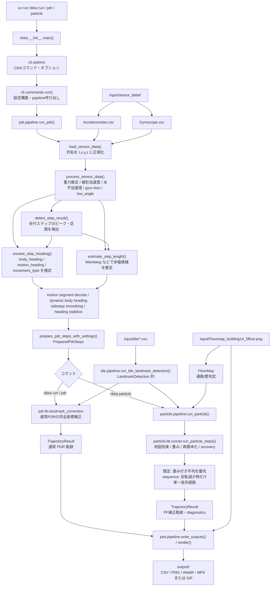
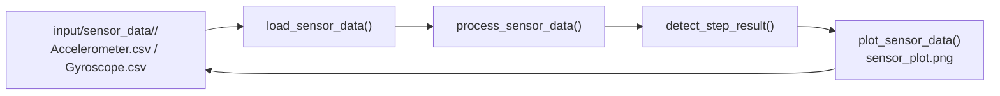
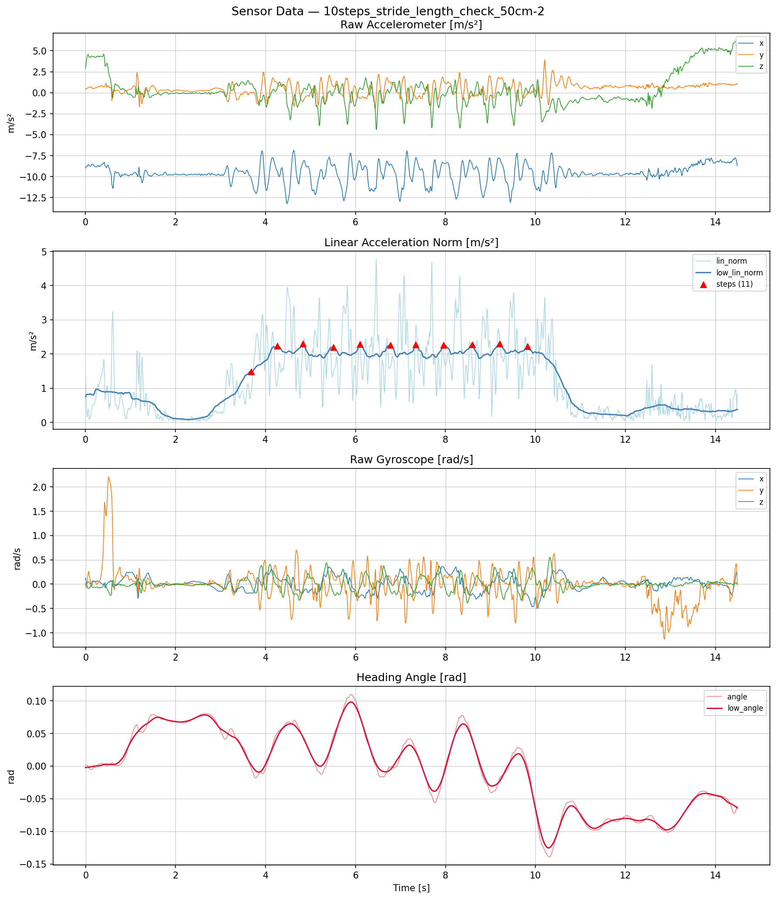
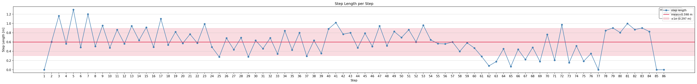

# rikka

スマートフォンの加速度計・ジャイロスコープ CSV から、屋内の歩行軌跡を推定する
PDR（Pedestrian Dead Reckoning）ライブラリです。

できることは次の3つです。

- **通常 PDR**: センサーだけで歩行軌跡を推定します。起点と初期方位を与えて、
  フロアマップ上の座標として出力します。
- **パーティクルフィルタによる地図マッチング**: 同じ歩行推定にフロアマップの
  壁情報を制約として掛け、通路内に収まる軌跡へ補正します。起点と初期方位を
  与えずに地図全体から探索するモードもあります。
- **BLE ランドマーク補正**: 既知座標に置いたビーコンの RSSI を観測として使い、
  累積誤差を抑えます。

付随する機能として、推定軌跡と正解軌跡の誤差評価、ランドマークだけを結んだ
基準経路の生成、滞在分析があります。

## 目次

- [クイックスタート](#クイックスタート)
- [コマンド早見表](#コマンド早見表)
- [入力データ](#入力データ)
- [通常 PDR](#通常-pdr)
- [パーティクルフィルタ](#パーティクルフィルタ)
  - [提案方式の選択](#提案方式の選択)
  - [診断用の出力](#診断用の出力)
- [起点と初期方位を与えない推定](#起点と初期方位を与えない推定)
  - [地図を使わない軌跡（`--free-origin`）](#地図を使わない軌跡--free-origin)
  - [地図全体から探索する PF（`--pf-init uniform`）](#地図全体から探索する-pf--pf-init-uniform)
  - [向きが定まらない地図について](#向きが定まらない地図について)
  - [前向きと後方の突き合わせ（`--pf-backward`）](#前向きと後方の突き合わせ--pf-backward)
- [BLE ランドマーク補正](#ble-ランドマーク補正)
  - [BLE CSV とランドマーク座標](#ble-csv-とランドマーク座標)
  - [実測 BLE の検出条件と入力形式](#実測-ble-の検出条件と入力形式)
  - [回帰テスト用の合成 BLE サンプル](#回帰テスト用の合成-ble-サンプル)
  - [PF のランドマーク反映モード（`--pf-landmark-mode`）](#pf-のランドマーク反映モード--pf-landmark-mode)
  - [確定位置アンカー（`--pf-hard-anchors`）](#確定位置アンカー--pf-hard-anchors)
  - [通過で位置が確定する地点（`BLE_LANDMARK_ANCHORS`）](#通過で位置が確定する地点ble_landmark_anchors)
  - [起点・方位の解決と RSSI 距離整合の診断](#起点方位の解決と-rssi-距離整合の診断)
  - [BLE 関連の CLI オプション](#ble-関連の-cli-オプション)
  - [BLE 有効時の出力](#ble-有効時の出力)
- [ランドマークのみの軌跡（`landmark-path`）](#ランドマークのみの軌跡landmark-path)
- [推定軌跡の精度評価](#推定軌跡の精度評価)
  - [正解軌跡との複数 seed 比較](#正解軌跡との複数-seed-比較)
  - [代表軌跡の選択と終端方向の検査](#代表軌跡の選択と終端方向の検査)
  - [通常 PDR の方式比較](#通常-pdr-の方式比較)
- [センサー波形の確認](#センサー波形の確認)
- [標準設定](#標準設定)
  - [歩幅係数と方位補正の校正状況](#歩幅係数と方位補正の校正状況)
  - [運動状態・方位・歩幅の逐次推定](#運動状態方位歩幅の逐次推定)
  - [robust と sequence の位置づけ](#robust-と-sequence-の位置づけ)
- [横歩き判定の見方](#横歩き判定の見方)
  - [判定の調整](#判定の調整)
- [ケイデンスに応じた歩検出（実験的）](#ケイデンスに応じた歩検出実験的)
- [ジャイロバイアス比較](#ジャイロバイアス比較)
- [主な出力](#主な出力)
- [データフロー](#データフロー)
- [コード構成](#コード構成)
  - [モジュールの責務分担](#モジュールの責務分担)
- [Python から使う](#python-から使う)
- [開発コマンド](#開発コマンド)
- [接続確認](#接続確認)

## クイックスタート

依存関係をインストールします。

```sh
uv sync --all-groups
```

既定の入力データで通常 PDR を実行します。プロットを表示し、`output/<実行時刻>/`
へ CSV と PNG を保存します。

```sh
uv run rikka run
```

グラフを表示せずバッチで確認する場合は `--no-plot` を付けます。CI や一括評価では
常にこちらを使ってください。プロット処理は `plt.show()` を呼び、表示を閉じるまで
ブロックします。

```sh
uv run rikka run --no-plot
```

パーティクルフィルタで地図制約を掛けた軌跡を得ます。

```sh
uv run rikka particle
```

### 動画出力に必要なもの

パーティクルフィルタのアニメーションは MP4 を優先し、生成できない場合は WebM、
それも生成できない場合は GIF へフォールバックします。MP4 と WebM には `ffmpeg`
が必要です。

```sh
brew install ffmpeg
```

### uv のキャッシュで権限エラーが出る場合

AI エージェントや sandbox 環境で `uv` の既定キャッシュに対する権限エラーが
発生した場合に限り、リポジトリ内キャッシュを指定して再実行します。

```sh
UV_CACHE_DIR=.uv-cache uv run pytest
```

## コマンド早見表

| コマンド | 用途 |
|---|---|
| `rikka run`（別名 `rikka pdr`） | 通常 PDR で軌跡を推定する |
| `rikka particle` | 通常 PDR の歩列にフロアマップ制約を掛けて補正する |
| `rikka sensor` | センサー波形と歩検出結果を画像で確認する |
| `rikka evaluate` | 推定軌跡と正解軌跡の誤差を計算する |
| `rikka landmark-path` | PDR を使わず、既知座標のランドマークを順に結んだ経路を出す |
| `rikka ble-sample` | 回帰テスト用の合成 BLE ログを生成する |

共通して `-d` で入力フォルダ、`--floormap` でフロアマップ画像、`--no-plot` で
プロット表示の抑止を指定できます。各コマンドの全オプションは `--help` で確認できます。

```sh
uv run rikka particle --help
```

## 入力データ

`input/sensor_data/<人名>/<データフォルダ>/` に phyphox 形式の CSV を置きます。
正解経路の動画・CSV・画像は `input/correct_path/<経路フォルダ>/` に分けて
配置します。フロアマップ画像は `input/` 直下に置きます。

```text
input/
├── sensor_data/
│   └── natsuki/
│       └── my_walk/
│           ├── Accelerometer.csv
│           └── Gyroscope.csv
├── correct_path/
│   └── my_walk/
│       └── walk_trace.csv
└── Floormap_building14_5floor.png
```

対応する列名は次の通りです。

| ファイル | 対応列 |
|---|---|
| `Accelerometer.csv` | `Time (s)`, `Acceleration x/y/z (m/s^2)` または `X/Y/Z (m/s^2)` |
| `Gyroscope.csv` | `Time (s)`, `Gyroscope x/y/z (rad/s)` または `X/Y/Z (rad/s)` |

### Android ロガー形式

Android ロガーの `acce.csv` / `gyro.csv`（`timestamp_ns, wall_time_ms, x, y, z`）
にも対応します。`metadata.json` の記録開始時刻を使い、単調時計の差から経過秒へ
変換します。

CLI は同じ `metadata.json` の start 制約から起点と初期方位を読み取ります。
ただし、明示的な CLI 引数と `walk_config.csv` があれば、そちらを優先します。

### 既定の入力フォルダ

既定値は `src/rikka/common/config/__init__.py` で次のように定義しています。

```python
DATA_DIR = "input/1024計測4号館1"
```

別のデータを使う場合は `-d` で指定します。

```sh
uv run rikka run -d input/sensor_data/natsuki/my_walk
```
## 通常 PDR

標準設定で歩行軌跡を推定します。`pdr` は `run` の別名です。

```sh
uv run rikka run
uv run rikka pdr
```

センサーから歩を検出し、歩ごとに方位と歩幅を推定して積み上げます。起点は
`--origin-px`、初期方位は `--direction`、縮尺は `--scale` で指定し、
省略時は[標準設定](#標準設定)の既定値を使います。

出力は `output/<実行時刻>/` に入ります。内容は[主な出力](#主な出力)を参照してください。

## パーティクルフィルタ

通常 PDR と同じ歩列に、フロアマップの壁情報を制約として掛けます。壁を越える
遷移を持つ粒子を捨てることで、通路内に収まる軌跡へ補正します。

```sh
uv run rikka particle
```

通常 PDR と particle filter は、同じ歩検出・方位推定・歩幅推定の結果
（`PreparedPdrSteps`）を共有します。particle 側で方位や歩幅を再推定することはありません。

粒子数の既定値は `rikka.common.config` の `PF_NUM_PARTICLES` です。実行単位で
変更する場合は CLI の `--pf-particles`、Python API の `particle_count` を使います。

乱数 seed は `--pf-seed` で固定できます。**固定 seed の結果は回帰確認用です。**
精度を評価するときは複数 seed で実行してください。

### 提案方式の選択

`--pf-proposal` で、各粒子の次の1歩をどう提案するかを選びます。
既定は `candidate-bank`、親粒子ごとの候補数は8です。

```sh
uv run rikka particle --pf-proposal legacy --pf-seed 0 --no-plot
uv run rikka particle --pf-proposal no-relocation --pf-seed 0 --no-plot
uv run rikka particle --pf-proposal candidate-bank --pf-candidates 8 \
  --pf-seed 0 --no-plot
```

| 方式 | 内容 |
|---|---|
| `candidate-bank`（既定） | 各親の通常運動モデルから K 個の方位・歩幅・状態・位置をまとめて生成し、地図と既存因子 G で候補を選ぶ |
| `legacy` | 従来の円内再配置。壁衝突した粒子を前歩位置中心の円内へ再配置する |
| `no-relocation` | 円内再配置だけを無効にし、生存粒子補充・ESS 再標本化・集団復旧は使う |

`candidate-bank` では、親重みに平均因子 `ΣG/K` を掛けます。採用した候補の G を
重ねて掛けることはしません。`--pf-candidates` はこの方式でのみ有効で、省略時は8です。
他の方式では省略時に1へ解決され、K=1 は円内再配置なしの単一提案に対応します。

BLE については、`candidate-bank` は `ranging` と `observation` に対応します。
BLE 因子は候補選択と平均因子へ一度だけ含め、復旧後は実際の復旧位置で再評価します。
BLE 適用済みの過去歩をまたぐ checkpoint 再生は、その観測の再生に対応するまで制限します。
最終軌跡の選択は BLE モード名から独立しており、通常の反転判定を使います。
`reset` / `hybrid` と既存の Gaussian アンカーは `legacy` で使ってください。

既定の歩幅・方位分布は従来のままです。**`candidate-bank` は広角探索の追加や
精度向上を意味しません。** 2計測・6 seed での比較、祖先多様性の低下、残存ジャンプ、
検証結果は `agent/EXPERIMENT_LOG.md` の実験一覧から該当エントリを参照してください。

### 診断用の出力

グラフを表示せず、アニメーションだけ保存します。

```sh
uv run rikka particle --no-plot --save-animation
```

問題のある歩について、粒子状態と代表軌跡候補を静止画で確認します。段階別画像は
既定で無効です。`--step-frames-arrows` で方位矢印の数、`--step-frames-dpi` で
解像度を調整できます。

```sh
uv run rikka particle --no-plot --pf-seed 10 \
  --save-step-frames --step-frames-range 70 85 \
  --save-path-comparison
```

#### 過去軌跡の修正候補（試作）

現行の再配置と前向き PF を維持したまま、過去軌跡の修正候補を別に比較する試作です。

```sh
uv run rikka particle --history-candidate --pf-seed 0 --no-plot
```

元の `trajectory.csv` と動画はそのまま保存し、候補の CSV と比較 PNG を追加します。

候補は、保存した生存粒子位置と元軌跡から地図上の接続を選び直すもので、
センサーに沿った再提案は行いません。始点・終点は元の仮境界を保持します。
全履歴を使う事後処理であり、オンラインの直近区間更新や歩幅・方位状態の再推定は
行いません。滑らかさを優先するため、経路を短縮する可能性があります。
BLE 補正が適用された歩は `skipped_landmark` として候補修正を省略します。

## 起点と初期方位を与えない推定

起点と初期方位は、通常は CLI 引数か計測設定から与えます。これらを与えずに
推定する手段が2つあります。目的が違うので使い分けてください。

| モード | 地図制約 | 出力座標 | 用途 |
|---|---|---|---|
| `--free-origin` | 使わない | (0, 0) 起点のメートル座標 | 歩行軌跡の形だけを見る |
| `--pf-init uniform` | 使う | フロアマップのメートル座標 | 地図全体から絶対位置を探索する |

### 地図を使わない軌跡（`--free-origin`）

起点と初期方位を与えずに歩行軌跡の形だけを見る場合に使います。座標 (0, 0) を
起点、方位オフセット 0 度として推定し、メートル座標のまま `trajectory_meter.png`
へ描画します。

```sh
uv run rikka pdr --free-origin
```

`--floormap` の画像があれば、地図の画素 (0, 0) を軌跡の起点に合わせて背景へ
敷きます。**地図へ合わせ込む補正は行いません。** 背景は位置関係を見るための
目安です。地図がない環境では軌跡だけを描画します。

このモードは地図座標を使わないため、`--origin-px`、`--direction`、`--ble-landmark`
とは併用できません。`walk_config.csv` や `metadata.json` がある計測フォルダでも、
起点と初期方位は読み込まず固定します。身長だけは `--height-m` を明示しない限り
計測設定の値を使います。

### 地図全体から探索する PF（`--pf-init uniform`）

起点も初期方位も与えず、フロアマップと `--scale` だけで軌跡を推定します。
粒子を地図の歩行可能領域へ一様に配置し、初期方位も一様に取って大域的に探索します。

```sh
uv run rikka particle --pf-init uniform --pf-particles 5000
```

メートル座標の原点は画像の画素 (0, 0) で、`pixel = meter / scale` の関係になります。
`--origin-px` と `--direction` とは併用できません。確定位置の経路選択は未対応のため、
`--pf-hard-anchors` も併用できません。

**粒子数は既定の 500 では足りません。** 一様配置では歩行可能面積あたりの密度が
精度を決めるため、`--pf-particles` で増やしてください。評価では 5,000 を実用点として
使っています。

通常モードとの違いは次の3点です。

- **recovery を行わない。** 地図を跨いだ粒子は重み0で捨てます。粒子が大量に死ぬのは
  大域探索の正常な動作で、通常の復旧処理はこれを異常として扱うためです。
  再標本化の ESS 閾値も `PF_GLOBAL_RESAMPLE_ESS_RATIO`（0.2）へ下げます。
  収束後に通常処理へ戻す `--pf-converge-restore-normal` もありますが、既定は無効です。
- **収束を観測する。** 毎歩、粒子を粗いグリッドで連結成分化し、クラスタ数・
  最大クラスタの重み比・広がり・重心を `convergence_diagnostics.csv` へ記録します。
  条件を満たした歩を収束歩 K として表示します。収束判定は記録だけを行い、
  処理の切り替えには使いません。
- **代表軌跡は遅延決定。** 全区間を走らせたあと、最終時点の最大クラスタで経路スコアが
  最大の粒子を選び、その祖先経路を代表軌跡にします。実在する粒子の経路なので
  壁を跨ぎません。

収束判定のしきい値は `--pf-converge-cell`、`--pf-converge-weight-ratio`、
`--pf-converge-spread`、`--pf-converge-steps`、`--pf-converge-top-k` で変更できます。

このモードで動画を保存すると、`particle_filter.mp4` に加えて `convergence_story.mp4`
が出力されます。左に地図と粒子分布、右に1歩目・候補が最も分かれた歩・収束歩の
固定サムネイル、下にフェーズの日本語説明を並べ、探索中・収束・追従の経緯を
追えるようにしたものです。冒頭と収束歩、末尾で静止します。最後に代表軌跡の祖先を
末尾から1歩目へ遡る巻き戻し区間を付け、収束前の区間が逆方向 PF ではなく
生き残った粒子の系譜であることを示します。

実装状況・到達精度・設計判断の根拠は
`agent/free-origin-pf-status-2026-11-09.md` にまとめています。

### 向きが定まらない地図について

地図の歩行可能領域が点対称に近い場合、推定した軌跡が**180度反転した位置に
置かれることがあります**。一本の直線廊下が主体の階が典型です。

反転した軌跡も地図制約を1つも破らないため、地図だけでは正しい向きを選べません。
粒子数を増やしても解決しません。4号館2階の記録を粒子 2,000〜10,000・seed 5本で
評価した結果、粒子 10,000 でも5実行中2実行が反転しました
（`agent/EXPERIMENT_LOG.md` の EXP-091）。

**この地図形状に由来する制約であり、修正対象としていません。**
向きを確定させたい場合は、地図上の絶対位置を与える観測が別途必要です。

一様初期化でも BLE ランドマークを併用できます。実測 BLE では
`--pf-landmark-mode ranging` を指定します。

```sh
uv run rikka particle -d input/1024計測4号館1 \
  --floormap input/Floormap_building4_2floor.png \
  --pf-init uniform --pf-particles 2000 \
  --ble-landmark --pf-landmark-mode ranging
```

実測での効果は次の通りです。

| 条件 | BLE なし | `ranging` 併用 |
|---|---|---|
| 4号館2階・粒子 2,000 | 5 seed すべて180度反転、基準から約 24.8 m | 5/5 成功、平均 0.78 m、収束歩 K は全 seed で8 |
| 14号館5階・粒子 2,000 | 1.46 m | 1.16 m、収束歩 K は 33〜48 から4へ安定 |

既知座標のビーコン2個の通過順が進行方向を一意に決めるため、向きの曖昧さが
解消します。`observation` は粒子 2,000 で5 seed 中3 seed が失敗したため
推奨しません。

### 前向きと後方の突き合わせ（`--pf-backward`）

`--pf-backward`（既定 off）で、終点側から確定済みの歩列を逆順に使う独立した PF を
追加実行します。前半で生き残った祖先が少ない前向きの代表軌跡を突き合わせるための
**検証専用**機能です。前向きの代表軌跡を置換したり融合したりはしません。
方位推定と gyro バイアス推定はやり直さず、同じ設定と seed を使います。

```sh
uv run rikka particle --pf-init uniform --pf-particles 5000 --pf-seed 42 \
  --pf-backward --no-plot
```

既存の出力に次が追加されます。

| ファイル | 内容 |
|---|---|
| `backward_trajectory.csv` | 前向きの歩順へ戻した後方経路 |
| `bidirectional_agreement.csv` | 元の歩番号と前後の座標・距離 |
| `bidirectional_comparison.png` | 青: 前向き、緑: 後方、赤: 距離が中央値の3倍超 |

距離集計と一致度には開始ノード（歩番号0）を含み、スキップされた歩は含みません。
CSV の後方軌跡は既存と同じ列・時刻形式で、開始ノードを除きます。PNG は `--no-plot`
でも保存し、開始点距離・距離の中央値・最大値を表示します。

`origin` 初期化でも使えますが、後方の起点には指定された `origin_px` をそのまま
使うため、主な検証対象は `uniform` です。運動状態の遷移は厳密な逆向き
マルコフ連鎖ではありません。

#### 解釈するときの注意

**前向きの正誤を判定するゲートには使えません。** 2計測12実行の実測では、
前向きが誤っていた5実行のうち検出できたのは3実行で、2実行は前後が同じ誤った向きへ
収束して一致してしまいました。逆に前向きが正しい7実行のうち3実行は後方だけが誤り、
不一致として現れました。曖昧さのある記録では、どちらが正しいかをこの指標では
決められません。

記録単位の曖昧さを検出したいだけなら、`convergence_diagnostics.csv` の
上位2クラスタの重心間距離のほうが安価で確実です（4号館15実行中14実行で検出、
14号館10実行では0件）。

直線廊下などの地図にある180度反転の曖昧さも解決しません。後方 PF も同じ仮説に
当たり得ます。食い違いは曖昧さの手掛かりであり、一致しても正解を保証しません。

BLE 測距を併用すると、両方向とも正しい向きへ収束します。粒子 2,000 の実測で
距離の中央値は4号館 1.79〜2.34 m、14号館 0.87〜1.53 m でした。この構成では
一致度が整合性の点検として意味を持ちます。

**後方の代表軌跡は前向きより精度が落ちます。** 同じ実測で基準 PF との平均距離は
前向き 0.66〜1.31 m に対し後方 1.61〜2.40 m でした。方位推定が因果処理で、
それを反転して使うだけだからです。後方軌跡を前向きと同等の推定として
扱わないでください。
## BLE ランドマーク補正

既知座標に置いた BLE ビーコンの RSSI が閾値以上になったとき、通常 PDR または
particle filter にランドマーク位置を反映できます。**BLE 測位は既定で無効です。**

実測データでは、計測ディレクトリに `BLE.csv`、`BLE_pos.csv`、`walk_config.csv` を
置きます。起点と方位を計測ごとに解決してから、PF の RSSI 測距尤度を使います。

```sh
uv run rikka particle -d 'input/1021日計測データ/1021_計測1回目' \
  --ble-landmark --pf-landmark-mode ranging --pf-seed 0 --no-plot
```

PF で BLE を使う場合は `--pf-landmark-mode ranging` または `observation` を
明示します。BLE は既定で無効、PF ランドマークモードの既定は従来の `hybrid` のままです。

- `ranging` は各歩・ビーコンの RSSI 中央値を測距尤度として使います。
- `observation` は接近を検出した歩だけ、周辺位置の尤度を使います。

同じ RSSI を両方の独立した観測として掛けることはしません。

**現在の既定パスロスモデルは 1021 データで校正されていません。** preflight 警告が
出る場合があります。軌跡が自然になったことや RSSI 残差が減ったことだけでは、
位置精度が上がったとは判断できません。比較結果は `agent/EXPERIMENT_LOG.md` の
実験一覧から該当エントリを参照してください。

### Android ロガー形式の BLE 入力

Android ロガーの計測では、小文字の `ble.csv` と、同じディレクトリの
`metadata.json` 内の `ble.configuration.beacons` にも対応します。
`beacon_id` と小数精度を維持した `pixel_x` / `pixel_y` を読み込み、
`enabled: false` の配置は除外します。

- 計測の `recording_context.floor_id` がある場合、有効ビーコンの `floor_id` と
  一致しなければ入力エラーになります。
- 同居する `BLE_pos.csv` があれば従来どおりそちらを優先します。
- `--ble-data` を明示した場合は、その CSV と同じディレクトリの配置を使います。
- 自動検出の順序は `BLE.csv`、`ble.csv` です。
- 座標の不備や有効 ID の重複を含む BLE 設定は、共通既定座標へフォールバックせず
  入力エラーにします。

metadata の設置座標を読み込んでも、歩行者の到達を保証する確定アンカーには
設定しません。地図画像と metadata の座標系・縮尺の対応は利用者が確認してください。

### 検出条件の由来を切り替える

`--ble-detection-profile auto|measured|synthetic` で接近検出条件の由来を
分離できます。`auto` は Thingsup 形式または BLE 配置 metadata 付きの計測を
実測として扱います。それ以外の標準 CSV は従来互換の条件を使い、実測 CSV には
`measured` を明示できます。**これは RSSI 測距モデルの校正とは別の設定です。**

### BLE CSV とランドマーク座標

BLE CSV は次の3列を持ちます。

| 列 | 内容 |
|---|---|
| `timestamp_s` | phyphox の実験開始からの経過秒 |
| `beacon_id` | `BLE_LANDMARKS_PX` に登録するビーコン識別子 |
| `rssi_dbm` | 受信 RSSI [dBm] |

ランドマーク座標は次の順に解決します。実測データでは入力側の配置が必ず優先されます。

1. 計測フォルダの `BLE_pos.csv`
2. 同フォルダの `metadata.json` の `ble.configuration.beacons`
3. `src/rikka/common/config/__init__.py` の `BLE_LANDMARKS_PX`

`BLE_LANDMARKS_PX` の既定値は**合成 BLE サンプル専用の架空配置**です。
14号館5階の地図上で歩行可能な3点を選んだだけの値で、実測ビーコンの設置座標では
ありません。`rikka ble-sample` の生成前提と、配置情報を持たない標準 CSV を
`--ble-data` で渡したときの最終既定値として使います。
**実測の軌跡や精度をこの座標で評価しないでください。**

`pixel_x` と `pixel_y` は `--origin-px` と同じ、フロアマップ画像の左上を
`(0, 0)` とするピクセル座標です。補正時に `--origin-px` と `--scale` を
使って PDR のメートル座標へ変換します。既定の検出下限は -70 dBm で、
ピーク時刻は5サンプルの移動中央値で安定化します。

### 実測 BLE の検出条件と入力形式

実測ログの検出は、次の3条件を要求します。

- 閾値以上が3観測続くこと
- 同一ビーコンの 10 秒 cooldown
- 6 dB 以上のピーク prominence

合成 BLE は既存 golden との互換性のため、従来の「1接近1検出」規則を維持します。

実測値へ差し替える場合は、同じ3列と経過秒の時間軸へ整形し、
`--ble-data <実測CSV>` を指定します。絶対時刻だけの場合は、phyphox の
`meta/time.csv` にある START の `system time` を引いて経過秒へ変換してください。

Thingsup 形式を `--ble-data` で明示した場合、同じディレクトリに `BLE_pos.csv` が
無ければ入力エラーになります。既定ランドマークへの無警告フォールバックは行いません。

### 回帰テスト用の合成 BLE サンプル

実測データがない場合は、回帰テスト用のサンプルを先に生成できます。

```sh
uv run rikka ble-sample
uv run rikka run --ble-landmark --no-plot
uv run rikka particle --ble-landmark --pf-landmark-mode ranging --no-plot
```

`ble-sample` は既定で、対象データの PDR 軌跡とビーコンの距離から RSSI を生成します。
評価用に正解軌跡を使う場合は `--source truth` を指定します。従来の固定ピーク時刻
方式は `--mode time` で利用できます。

```sh
uv run rikka ble-sample \
  -d input/sensor_data/natsuki/1turn_rightsidestep_3turn_leftsidestep \
  --source truth \
  --truth-csv "input/correct_path/1turn_rightsidestep_3turn_leftsidestep/walk_trace (3).csv"
```

### PF のランドマーク反映モード（`--pf-landmark-mode`）

particle filter では `--pf-landmark-mode` で反映方式を選びます。

既定の `candidate-bank` 提案方式で BLE を反映できるのは `ranging` と `observation`
だけです（`none` は反映無効として指定可能）。`hybrid` や `reset` を使う場合は、
`--pf-proposal legacy` または `no-relocation` を指定してください。

- `none`: 検出を軌跡へ反映しません。BLE 無効時と固定 seed の結果が一致します。
- `observation`: ランドマーク距離の下限付きガウス尤度を、粒子重みと sequence
  経路スコアへ加えます。
- `reset`: ランドマーク周辺の歩行可能位置へ粒子を再配置します。比較実験用で、
  位置以外の heading drift・stride scale・motion state は引き継ぎます。祖先経路が
  不連続になるため、reset 使用時の代表軌跡は `pf-path-selection` にかかわらず
  時点別の current 経路を使います。
- `hybrid`（既定）: ランドマーク距離が粒子群の広がりの4倍以内なら observation、
  それより遠く、かつ距離が 2 m を超える場合は reset を使います。通常 reset の
  距離が 5 m を超える検出は、安全のため再配置せず通常の PF 更新を続けます。
  確定ランドマークはこの判定より優先されます。
- `ranging`: RSSI 領域でパスロスモデルの期待値と観測値を比較します。弱い RSSI は
  遠い粒子を支持し、reset を行わないため、祖先経路の再重み付けで検出前の軌跡にも
  観測が反映されます。`pf-path-selection=sequence` では合法な単一祖先経路を
  選びます。**実測 BLE ではこの方式を使ってください。**

観測尤度の既定値は `sigma=1.0 m`、`floor=0.05` です。合成 BLE と対応する正解軌跡の
6 seed 評価で選んだ値なので、実測 BLE を取得した後は再校正が必要です。

`--pf-landmark-retrofit` は既定で無効です。確定ランドマークが粒子を再配置した歩で、
代表経路選択後のアンカー直前区間だけを相似変換し、位置ジャンプを解消します。
粒子履歴と重みは変更せず、変換後の全辺が歩行可能な場合だけ採用します。

PF の `landmark_corrections.csv` にある `before` / `after` は、反映前後の粒子
重み付き平均です。`raw_trajectory` の描画は、同じ歩列から作った通常 PDR 軌跡を表します。

### 確定位置アンカー（`--pf-hard-anchors`）

`--pf-hard-anchors anchors.json` は、歩行者が実際にその位置にいた根拠があるときの
前向き再初期化です。**metadata のビーコン設置座標や強い RSSI だけでは自動生成しません。**

JSON は次の配列形式です。数値は形式説明用で、実測の到達証明を表しません。

```json
[
  {
    "event_id": "confirmed-arrival-1",
    "timestamp_s": 1.0,
    "pixel_x": 100.5,
    "pixel_y": 200.5,
    "source": "manual",
    "evidence": "計測時に記録した到達確認"
  }
]
```

```sh
uv run rikka particle --pf-hard-anchors anchors.json \
  --pf-landmark-mode none --pf-seed 0 --no-plot
```

時刻はセンサー開始基準の秒で、`step_headings.csv` の `timestamp_s` にある使用歩の
境界時刻へ厳密に一致させてください。**`trajectory.csv` の時刻は最初の使用歩基準なので、
その値をそのまま転用しないでください。** 歩間時刻の補間と過去区間の再推定は
未対応です。位置・根拠・時刻の矛盾は入力エラーにします。

任意の `heading_deg` を指定したときだけ方位も合わせます。位置のみを指定した場合は
方位・歩幅倍率の仮説を維持します。任意の `floor_id` を指定する場合は、対応する
使用地図の ID を `--floormap-floor-id` でも明示してください。計測 metadata の
階 ID だけで任意画像の一致を推測することはしません。

確定点では全粒子をその位置へ合わせ、完了した過去区間を固定して追跡を再開します。
出力は次の通りです。

| ファイル | 内容 |
|---|---|
| `hard_anchor_corrections.csv` | 根拠と訂正前後の座標 |
| `trajectory_segments.csv` | 歩行距離と位置訂正距離を分けて記録 |
| `trajectory.csv` | 区間 ID と位置訂正フラグの列が追加される |
| `trajectory_before_anchor_nodes.csv` | アンカーノードだけを補正直前へ戻した診断列 |

`trajectory_before_anchor_nodes.csv` は、BLE なし・確定位置なしで再実行した軌跡では
**ありません。** 軌跡図とアニメーションでは位置訂正を赤い破線で描き、歩行経路と
区別します。

従来の `step_vectors.csv` の点間差には位置訂正も含まれます。hard 使用時の歩行距離は
`trajectory_segments.csv` の `walking_distance_m` を参照してください。

詳しい設計は `agent/new-pf-ble-integration-plan-2026-10-23.md` を参照してください。

### 通過で位置が確定する地点（`BLE_LANDMARK_ANCHORS`）

改札・自動ドア・踊り場のように、通過した事実から位置を確定できる地点は
`BLE_LANDMARK_ANCHORS` へ追加します。既定値は空で、通常ランドマークの挙動には
影響しません。

```python
BLE_LANDMARK_ANCHORS = (
    # beacon_id, 位置σ[m], 方位[deg], 方位σ[deg], 双方向か
    ("beacon_3", 0.3, 90.0, 15.0, True),
)
```

方位は `0=+X`、`90=+Y`、反時計回りが正です。方位を確定しない場合は3要素目を
`None` にします。

確定ランドマークは PF の距離比と 5 m 上限によらず、指定したσの範囲へ粒子を
再配置します。方位を指定した場合は、絶対方位差を減衰しない補正項へ反映します。
大きなジャンプは停止せず警告します。**強制補正なので、実測データで検出時刻と
通過時刻が一致することを確認してから設定してください。**

### 起点・方位の解決と RSSI 距離整合の診断

`walk_config.csv` がある場合の解決順は、CLI の明示値、計測設定、共通既定値です。

診断は `corr(RSSI, log10(distance)) <= -0.5` かつパスロス係数 `1.5 <= n <= 4.0` を
合格条件とします。

```sh
uv run python agent/agent_diagnose_ble_ranging.py \
  -d input/senser_data_withBLE/natsuki/WithBLE_1
uv run rikka particle \
  -d input/senser_data_withBLE/natsuki/WithBLE_1 \
  --ble-landmark --pf-landmark-mode ranging --no-plot
```

**RSSI から逆算した探索起点は検算用であり、実測起点の代わりにはしません。**

### BLE 関連の CLI オプション

| オプション | 内容 |
|---|---|
| `--ble-landmark` | BLE 補正を有効化 |
| `--ble-data PATH` | BLE CSV を指定 |
| `--ble-rssi-threshold DBM` | 検出下限を変更 |
| `--ble-release-margin DB` / `--ble-release-streak N` | ラッチ解除条件 |
| `--ble-sync-window S` | 同時受信としてまとめる時刻窓 |
| `--ble-preflight warn\|error\|off` | RSSI 距離整合 FAIL 時の扱い |
| `--ble-max-correction M` | 実際の補正移動量の上限。既定 8 m |

通常 PDR の補正方式は `--ble-correction snap|warp|similarity` で選びます。
既定は `warp` です。

- `warp`（既定）: 直前拘束からの累積歩行距離比で残差を過去へ配分します。
- `similarity`: 直前アンカーを固定して過去区間を回転・等方スケールし、同じ量を
  確定方位と歩幅へ反映します。
- `snap`: 補正量をすべて検出歩へ集中させるため軌跡に不連続を作りますが、
  後方互換のため選択肢として維持しています。

`similarity` と `warp` の安全条件は次で調整します。

- `--ble-max-warp-span M`: warp 区間の累積歩行距離上限。累積距離は補正量を
  表さないため既定では制限せず、必要な実験でだけ明示します。
- `--ble-retrofit-forward hold|freeze`: `similarity` の回転・倍率を後続歩にも
  保持するか、検出歩までで固定するかを選びます。既定は `hold` です。
- `--ble-retrofit-max-heading`、`--ble-retrofit-stride-scale-min/max`、
  `--ble-retrofit-min-span`: 回転角・歩幅倍率・最小アンカー間距離の安全条件です。
- `--ble-retrofit-map-check off|warn|enforce`: 地図違反を無視、警告、減衰後も
  違反する補正の棄却、のいずれかで扱います。減衰列は
  `--ble-retrofit-damp-factor` を複数指定して変更できます。

### BLE 有効時の出力

BLE 有効時は `output/<実行時刻>/landmark_corrections.csv` に、検出時刻、RSSI、
補正前座標、ランドマーク座標、補正後座標、検出距離、最接近時間差、アンカーの
位置・方位設定を保存します。`similarity` では回転角、歩幅倍率、減衰係数、
地図違反辺数、棄却理由も保存します。

補正後の `step_headings.csv` には累積方位補正と累積歩幅倍率が入ります。
`step_lengths.csv` と合わせて再積分すると、軌跡に一致します。

`trajectory.png`（PF では `pf_trajectory.png`）には、`BLE_pos.csv` で座標が
確定した全ビーコンを星印で表示し、補正前後の軌跡と補正地点を重ねて描画します。

最終歩より後で補正できなかった検出は、`step=-1`、`applied=False` として CSV に残ります。
## ランドマークのみの軌跡（`landmark-path`）

PDR を使わず、既知座標のランドマークを順に直線で結んだだけの軌跡を出力します。
既定では計測フォルダのランドマーク配置を読みます。

```sh
uv run rikka landmark-path -d input/1024 \
  --floormap input/Floormap_building14_5floor.png
```

座標の出所は PDR の BLE ランドマークと同じ優先順位で、`--landmark` の明示指定、
計測フォルダの `BLE_pos.csv`、同フォルダの `metadata.json` の BLE 配置、
`src/rikka/common/config/__init__.py` の `BLE_LANDMARKS_PX` の順に解決します。
どれを使ったかは実行時に表示します。`BLE_LANDMARKS_PX` は合成サンプル用の
座標なので、実測の配置とは一致しません。

座標を直接指定する場合は `beacon_id:ピクセルX:ピクセルY` を経路順に並べます。

```sh
uv run rikka landmark-path \
  --landmark lm_1:2175:420 \
  --landmark lm_2:2026:583 \
  --landmark lm_3:1181:458
```

経路順は `--order` で選びます。

- `rssi-peak`（既定）: 計測フォルダの BLE ログで平滑 RSSI が最大になった時刻、
  つまり最接近時刻の順に結びます。受信がないランドマークは経路へ含めません。
  除外したランドマークは実行時に表示し、受信があるランドマークが2点未満になる
  場合は経路にならないため実行を中止します。
- `given`: 座標の指定順をそのまま使います。BLE ログが無い場合もこの順になります。

ピクセル座標は `--floormap` で指定した画像の左上を原点とし、画像外の座標は
実行前にエラーにします。

出力先は `output/<実行時刻>/` で、内訳は `landmark_path.csv` と `landmark_path.png`
です。CSV には経路順の `order`、`beacon_id`、ピクセル座標、先頭ランドマークを
原点とするメートル座標（画像の上方向が +Y）、区間距離、累積距離が入ります。

## 推定軌跡の精度評価

解析で生成した推定軌跡 CSV と、同じフロア座標系で作成した正解軌跡 CSV を、
記録開始からの経過秒で突き合わせて評価します。

```sh
uv run rikka evaluate \
  --estimated-csv output/trajectory.csv \
  --truth-csv input/correct_path/my_walk/walk_trace.csv \
  --floor-scale 0.01 \
  --tolerance-m 1.0 \
  --output-dir output/evaluation
```

既存の rikka 出力では先頭に時刻が空の初期位置が入るため、その行は評価せず
2点目以降を対象にします。正解軌跡の範囲外にある推定点も評価対象から除外します。

`--floor-scale` は1 px あたりのメートル数です。既定の座標系はフロアマップの
ピクセル座標で、メートル座標の CSV を評価する場合は `--coordinate-system meter`
を指定し、`--floor-scale` は不要です。

結果は2ファイルに保存します。

| ファイル | 内容 |
|---|---|
| `evaluation.csv` | 点ごとの誤差 |
| `evaluation.json` | MSE・RMSE・MAE・P95・最大誤差・許容誤差内率・評価対象率 |

### 正解軌跡との複数 seed 比較

```sh
MPLBACKEND=Agg uv run python \
  agent/agent_evaluate_pf_ground_truth.py \
  --plot-path output/diagnostics/pf_ground_truth_comparison.png
```

### 代表軌跡の選択と終端方向の検査

単一計測では、方位ドリフト後に地図上の対称な分岐へ到達すると、壁交差がなくても
逆側の廊下へ収束し、単一 PF だけでは一意に直せない場合があります。

複数計測の代表軌跡を作るときは、終端15%の方向を計測・PDR/PF 方式ごとに等重みで
比較し、多数方向から90度を超えて外れる候補を除外してから medoid を選びます。
**正解軌跡はこの選択には使用せず、選択後の評価だけに使います。**

評価 CSV / JSON では次も確認してください。

| 列 | 意味 |
|---|---|
| `terminal_direction_error_deg` | 正解終端区間との方位差 |
| `terminal_progress_cosine` | 正解終端方向への投影。負なら逆向き |
| `terminal_opposed_fraction` | 終端15%で対応接線が90度以上逆向きの割合 |
| `terminal_direction_failure` | projection が負、または逆向き割合が 0.5 以上 |

### 通常 PDR の方式比較

同じ正解ルートに対応するデータをまとめて指定できます。

```sh
MPLBACKEND=Agg uv run python agent/agent_evaluate_adaptive_pdr.py \
  --data-dir \
  input/sensor_data/natsuki/1turn_rightsidestep_3turn_leftsidestep \
  input/sensor_data/natsuki/1turn_rightsidestep_3turn_leftsidestep5 \
  input/sensor_data/natsuki/1turn_rightsidestep_3turn_leftsidestep6 \
  input/sensor_data/natsuki/1turn_rightsidestep_3turn_leftsidestep7 \
  input/sensor_data/natsuki/1turn_rightsidestep_3turn_leftsidestep8
```

## センサー波形の確認

軌跡推定までは進まず、前処理とステップ検出の結果を入力フォルダ内の
`sensor_plot.png` へ保存します。同名ファイルがある場合は `sensor_plot_001.png`
のように連番を付けます。

```sh
uv run rikka sensor
```

## 標準設定

既定値の正は `src/rikka/common/config/__init__.py` です。ここでは主要なものを
抜粋します。

### 入力と座標系

| 項目 | 既定値 | 説明 |
|---|---:|---|
| `DATA_DIR` | `input/1024計測4号館1` | 入力データ |
| `FLOORMAP_PATH` | `input/Floormap_building4_2floor.png` | 背景マップ |
| `FLOORMAP_ORIGIN_PX` | `(2175, 231)` | 軌跡の開始ピクセル |
| `FLOORMAP_SCALE` | `0.01` | 1 px あたりのメートル数 |
| `INITIAL_DIRECTION` | `90.0` | 歩行開始方向 [deg] |

### 歩検出・方位・歩幅

| 項目 | 既定値 | 説明 |
|---|---:|---|
| `STEP_DETECTION_METHOD` | `adaptive_peak` | 周期に応じた歩検出（オフライン） |
| `HEADING_METHOD` | `gyro_accel_motion` | 方位・移動方向推定 |
| `FORWARD_HEADING_SOURCE` | `body` | 通常歩行はジャイロ由来の体・端末方向を使用 |
| `GYRO_BIAS_METHOD` | `prewalk_guarded` | 小さい歩行前 bias だけを採用し、端末回転の誤認を抑制 |
| `USER_HEIGHT_M` | `1.68` | Weinberg 歩幅補正用の身長 |
| `WEINBERG_REFERENCE_K` | `0.39` | 歩幅係数（基準身長 1.70 m）。暫定校正値 |
| `MOTION_ESTIMATION` | `adaptive` | 運動状態・方位・歩幅を確率状態として逐次推定 |
| `SMOOTHING_MODE` | `causal` | 各歩までの観測だけを使う因果推定 |

### 横歩きと旋回

| 項目 | 既定値 | 説明 |
|---|---:|---|
| `SIDESTEP_LATERAL_RATIO` | `1.2` | 横方向/前方向の比率がこの値以上で横歩き候補 |
| `SIDESTEP_MIN_LATERAL_DISPLACEMENT_M` | `0.03` | 横歩き判定に必要な横方向変位 [m] |
| `SIDESTEP_SMOOTHING_METHOD` | `clustered` | 同方向 evidence の連続クラスタを評価し、確定横歩きまたは横歩き疑いとして軌跡へ反映 |
| `SIDESTEP_LENGTH_SCALE` | `0.8` | 横歩き歩幅の倍率 |
| `TURNING_LENGTH_SCALE` | `0.3` | 旋回中歩幅の倍率 |

### PF のパラメータ

| 項目 | 既定値 | 説明 |
|---|---:|---|
| `PF_NUM_PARTICLES` | `500` | 粒子数。`--pf-init uniform` では不足するので増やす |
| `PF_PROPOSAL_METHOD` | `candidate-bank` | 候補生成方式 |
| `PF_CANDIDATE_COUNT` | `8` | `candidate-bank` の親粒子ごとの候補数 |
| `PF_INIT_MODE` | `origin` | 初期分布。`uniform` で地図全体から探索 |
| `PF_PATH_SELECTION` | `sequence` | 持続反転が減る場合だけ単一祖先経路を採用 |
| `PF_SIGMA_INIT_HEADING` | `0.26` | 初期方位ばらつき [rad]（約 14.9 度） |
| `PF_SIGMA_HEADING` | `0.14` | 1歩ごとの方位ドリフト [rad/step]（約 8.0 度） |
| `PF_HEADING_DRIFT_RETENTION` | `0.85` | 方位ドリフトを次歩へ保持する割合 |
| `PF_SIGMA_STEP_LENGTH_RATIO` | `0.01` | 永続倍率で説明できない1歩ごとの歩幅ノイズ |
| `PF_STRIDE_SCALE_PRIOR_MEAN` | `1.0` | 歩幅倍率の事前中心 |
| `PF_STRIDE_SCALE_RETENTION` | `0.995` | 学習した歩幅倍率偏差を次歩へ保持する割合 |
| `PF_STRIDE_SCALE_MIN` / `MAX` | `0.80` / `1.30` | 保持する歩幅倍率の範囲 |
| `PF_RESAMPLE_ESS_RATIO` | `0.5` | ESS が粒子数の50%未満なら全粒子を再標本化。それ以外では死亡枠だけ補充 |
| `PF_GLOBAL_RESAMPLE_ESS_RATIO` | `0.2` | `uniform` の大域探索中に使う ESS 閾値 |
| `PF_INVALID_RELOCATION_RADIUS_M` | `5.0` | 壁衝突した粒子を前歩位置中心の円内へ再配置する半径 [m] |
| `PF_REJUVENATION_SIGMA_HEADING` | `0.12` | 再標本化後に加える適応方位ノイズの上限 [rad] |
| `PF_RECOVERY_VALID_RATIO` | `0.05` | map-aware recovery を開始する有効粒子率 |
| `PF_MOTION_PREDICTIVE_WEIGHT_POWER` | `0.1` | 運動状態予測尤度を弱く重みへ反映する指数 |

方位ばらつきは「おおむね -30〜+30 度」を2シグマ相当の範囲として設計しています。
`PF_SIGMA_INIT_HEADING` と `PF_SIGMA_HEADING` は、AR(1) の定常標準偏差が
約15度になるよう選んだ組です。片方だけを変えると設計意図から外れます。

### 歩幅係数と方位補正の校正状況

Weinberg 歩幅係数の基準値は 0.39 です。14号館の `input/1024` と4号館の
`input/1024計測4号館1` を、それぞれ対応する新地図（1 px = 1 cm）で比較して選んだ
暫定値です。**旧地図の座標を持つ 1021・WithBLE や、別人・別端末での最適性は
確認していません。** 歩数を減らして距離を合わせる変更や、全粒子の歩幅を固定する
変更はしていません。

PF 歩幅倍率の事前中心は 1.0 です。通常 PDR の歩幅推定には影響しません。
全粒子の歩幅を固定する設定ではなく、地図制約による選択と倍率状態の変動は維持します。
標準地図は Group 21 由来の 2315×3746 px 画像（1 px = 1 cm）へ置き換えています。
1024 の6 seed・BLE 有無の比較では、1.25 は右側の縦通路へ偏ったため 1.0 へ戻しました。
BLE 併用時の終点のばらつきや代表経路のジャンプは残っており、別人・端末・経路での
最適性は未確認です。**旧地図に対する 1021・WithBLE の座標は、そのまま新地図へ
流用しないでください。**

方位補正の全体既定値は `prewalk_guarded` を維持します。4号館の記録では、
既存 CLI の手動バイアスを明示した校正条件も利用できます。**この値は今回の記録向けで、
別の計測へ自動適用しません。** PF では手動補正により大きな移動が減る一方、
停止位置の深さ誤差は既定補正より増える条件もあります。

```sh
# 4号館：通常PDRの校正条件
uv run rikka run -d 'input/1024計測4号館1' \
  --floormap input/Floormap_building4_2floor.png \
  --gyro-bias-method manual --gyro-bias -0.003 --no-plot

# 4号館：同じ方位補正を使うPF（BLE併用は --ble-landmark --pf-landmark-mode ranging を追加）
uv run rikka particle -d 'input/1024計測4号館1' \
  --floormap input/Floormap_building4_2floor.png \
  --gyro-bias-method manual --gyro-bias -0.003 --pf-seed 0 --no-plot

# 14号館：地図を明示し、方位補正は全体既定値を使用
uv run rikka particle -d input/1024 \
  --floormap input/Floormap_building14_5floor.png --pf-seed 0 --no-plot
```

### 運動状態・方位・歩幅の逐次推定

標準設定は `adaptive + causal` です。`causal` は各歩までの観測だけを使い、
`offline` は記録全体を使って運動状態列を後向き平滑化します。

```sh
uv run rikka run
uv run rikka particle --pf-seed 42
uv run rikka particle --motion-estimation adaptive --smoothing offline --pf-seed 42
uv run rikka run --motion-estimation robust --smoothing causal
```

運動状態の予測尤度は、5記録・6 seed 評価で最も安定した指数 `0.1` を標準値として
弱く PF 重みへ反映します。今回の評価では、中央値を優先する場合は `offline`、
最悪 seed の RMSE を優先する場合は `causal` が良い結果でした。

```sh
uv run rikka particle --motion-estimation adaptive \
  --motion-predictive-weight-power 0.1 \
  --pf-path-selection sequence --pf-particles 500 --pf-seed 42
```

### robust と sequence の位置づけ

`robust` は、移動軸の180度方向の曖昧性を区間で解決する**実験方式**です。
5反復計測では一部データを改善した一方で中央値を悪化させたため、既定や推奨へは
昇格していません。

`sequence` は、反転が実際に減る場合だけ単一粒子の完全な祖先経路を使い、
それ以外は到達可能な平均経路へ戻る**標準設定**です。

### 方位の内訳

標準の `gyro_accel_motion` は、ジャイロの端末方位と水平加速度の移動軸を分離します。
横歩きを連続区間で復号し、安定区間から端末と身体の時変方位差を推定します。
通常歩行は補正後の `body_heading`、確定した横歩きは `motion_heading` を使い、
端末だけを曲げた量が進行方向へ直接入らないようにしています。確定しなかった
単発候補は前進扱いにします。

`step_headings.csv` では次を分けて記録します。

| 列 | 内容 |
|---|---|
| `body_heading` | ジャイロから推定した体/端末の向き |
| `motion_heading` | 水平加速度から推定した1歩ごとの移動方向特徴 |
| `movement_type` | センサー上の判定結果 |
| `trajectory_movement_type` | 軌跡計算に使った移動タイプ |
| `forward_heading_source` | `forward` 判定ステップの軌跡方位ソース |

## 横歩き判定の見方

実行後、`output/<実行時刻>/step_headings.csv` を確認します。重要な列は次です。

| 列 | 意味 |
|---|---|
| `movement_type` | センサー上の判定。`sidestep_left/right` なら横歩きとして検出済み |
| `trajectory_movement_type` | 軌跡に反映した移動タイプ。`forward` なら検出は横歩きだが軌跡上は前進扱い |
| `body_heading_deg` | 体/端末の向き |
| `motion_heading_deg` | 水平加速度から見た移動方向 |
| `selected_heading_deg` | 実際に軌跡へ使った方位 |
| `forward_heading_source` | `forward` 判定ステップの軌跡方位ソース |
| `lateral_forward_ratio` | 横方向変位 / 前方向変位 |
| `forward_displacement` | 体方向への変位特徴 |
| `lateral_displacement` | 横方向への変位特徴 |
| `motion_heading_correction_deg` | 水平加速度方向の補正角 |
| `decoded_motion_mode` | 区間復号した `forward / sidestep_left / sidestep_right` |
| `device_body_offset_deg` | 歩ごとに推定した端末−身体方位差 |
| `body_heading_update_reason` | 動的方位を更新したか、更新を止めた理由 |

標準設定の `clustered` では、同方向の横歩き evidence が連続する区間をクラスタとして
評価します。条件を満たす1歩の隙間は最大1つまでクラスタに含め、横歩き evidence が
2歩以上かつクラスタ全体の横方向変位が閾値を満たす場合に、確定横歩きとして軌跡へ
反映します。

確定しなかった強い単発 evidence は、標準の `--sidestep-suspect-mode forward` では
`trajectory_movement_type="forward"` として前進扱いにします。また、`forward` 判定
ステップはジャイロ由来の `body_heading` で軌跡へ積みます。比較のため水平加速度由来の
`motion_heading` で積む場合は次を指定します。

```sh
uv run rikka run --forward-heading-source motion
```

### 判定の調整

横歩き判定を軌跡へそのまま反映して比較する場合:

```sh
uv run rikka run --sidestep-smoothing none
```

旧方式の単発横歩き抑制と比較する場合:

```sh
uv run rikka run --sidestep-smoothing isolated
```

横歩き判定を増やす / 減らす場合:

```sh
# 拾いやすくする
uv run rikka run --sidestep-lateral-ratio 1.0

# 厳しくする
uv run rikka run --sidestep-lateral-ratio 1.5
```

## ケイデンスに応じた歩検出（実験的）

`--step-detection adaptive_peak` で、局所的な歩行周期に応じて近接ピークを
除外する方式を選べます。**現在の既定は `adaptive_peak` です。** 従来方式は
`--step-detection peak` で選択できます。

```sh
# 通常PDR
uv run rikka run --step-detection adaptive_peak

# 従来PFの歩検出だけを切り替える
uv run rikka particle --step-detection adaptive_peak --pf-proposal legacy --pf-seed 0

# フェーズ2の候補生成方式と組み合わせる
uv run rikka particle --step-detection adaptive_peak --pf-proposal candidate-bank --pf-candidates 8 --pf-seed 0
```

前後3秒の加速度から自己相関と候補間隔を調べ、実時刻でピークを選びます。
周期の探索範囲は 0.33〜1.2 秒で、周期が不明な区間は暫定の最小間隔 0.4 秒を
使用します。停止・微小振動と弱い副峰を除外し、周期から架空の歩は追加しません。

**前後の信号を使うオフライン方式です。** `--smoothing causal` を指定しても
歩検出自体は因果処理になりません。

通常の CSV に加え、`step_detection_diagnostics.csv` に全候補の時刻、推定周期、
支持指標、最小間隔、突出度、採否と理由を出力します。候補がなくてもヘッダーは
保存します。`confidence` は自己相関または候補間隔の支持率であり、**正解の確率では
ありません。**

1歩と2歩の周期の曖昧さ、端末の振り方、低い信号強度には限界があります。
1021 データでの検出数増加は測位精度の改善を保証せず、1019 データでは既存方式より
検出数が減る例もあります。比較結果は `agent/EXPERIMENT_LOG.md` の実験一覧から
該当エントリを参照してください。

## ジャイロバイアス比較

定速の端末回転を静止中の bias と誤認すると、全区間へ誤った補正が入り軌跡が
曲がり続けます。そのため標準の `prewalk_guarded` は、推定値が ±0.003 rad/s 以内の
場合だけ採用し、それを超える場合は0へ戻します。

| 方式 | 用途 |
|---|---|
| `prewalk_guarded`（既定） | 小さい歩行前 bias だけを採用する |
| `prewalk_robust` | 記録前後に確実な静止区間を用意できる場合 |
| `zero` | 補正しない比較 |
| `manual` | 既知の校正値がある場合 |

```sh
uv run rikka run \
  -d input/sensor_data/natsuki/1turn_rightsidestep_3turn_leftsidestep2 \
  --gyro-bias-method manual \
  --gyro-bias 0.002
```
## 主な出力

通常 PDR は `output/<実行時刻>/` に保存します。

| ファイル | 内容 |
|---|---|
| `trajectory.csv` | 移動後座標。列は `timestamp_s,x,y` |
| `trajectory.png` | フロアマップ上の軌跡 |
| `step_lengths.csv` | ステップごとの歩幅 |
| `step_length_observations.csv` | 1歩区間の歩幅候補、周期、振幅、品質、不確かさ |
| `motion_posteriors.csv` | `adaptive` 時の運動状態確率、方位・歩幅・端末姿勢ずれの事後分布 |
| `direction_posteriors.csv` | `robust` 時の移動軸2方向の確率、採用方位、反転根拠 |
| `step_lengths.png` | 歩幅グラフ |
| `step_vectors.csv` | ステップごとの変位ベクトル |
| `step_vectors/step_*.png` | 各ステップの変位と加速度分布 |
| `step_headings.csv` | 方位候補、横歩き判定、軌跡反映タイプ |
| `gyro_bias.csv` | ジャイロバイアス推定の診断情報 |
| `step_segments.csv` | `paper_vertical_threshold` 使用時のステップ区間 |
| `trajectory_meter.png` | `--free-origin` 指定時の (0, 0) 起点メートル座標の軌跡。地図があれば画素 (0, 0) を起点に背景へ重ねる。`trajectory.png` の代わりに保存 |

パーティクルフィルタでは追加で次を保存します。

| ファイル | 内容 |
|---|---|
| `pf_trajectory.png` | PF の平均優先、または反転抑制された単一祖先軌跡 |
| `particle_diagnostics.csv` | 各歩の ESS、有効粒子数、位置・方位分散、歩幅倍率、recovery、軌跡選択モード |
| `particle_filter.mp4` / `.webm` / `.gif` | パーティクル分布アニメーション |
| `particle_relocations.csv` | 通常提案を再配置で置き換えたイベント。checkpoint 等の復旧で置換された歩は含めない |
| `particle_frames/step_*.png` | 明示保存時の開始・提案・壁判定・重み・選択/復旧・確定と方位ローズ |
| `particle_paths_comparison.png` | 明示保存時の加重平均・単一祖先・個別粒子経路と方位変化の比較 |

`--pf-init uniform` 指定時は次が加わります。

| ファイル | 内容 |
|---|---|
| `convergence_diagnostics.csv` | 各歩のクラスタ数、最大クラスタの重み比・広がり・重心、上位クラスタ |
| `convergence_history.png` | クラスタ数と最大クラスタ広がりの推移。赤破線が収束歩 K |
| `convergence_story.mp4` / `.webm` / `.gif` | 探索・収束・追従を説明するアニメーション |

`--pf-backward` 指定時は次が加わります。

| ファイル | 内容 |
|---|---|
| `backward_trajectory.csv` | 後方 PF の代表軌跡（前向きの歩順、既存軌跡と同じ列） |
| `bidirectional_agreement.csv` | 歩番号、前後の座標、一致距離 [m] |
| `bidirectional_comparison.png` | 地図上の前後比較と距離集計 |

`--history-candidate` 指定時は次が加わります。

| ファイル | 内容 |
|---|---|
| `particle_history_candidate.csv` | 原点を含む元/候補座標、センサー時刻、修正量、参照粒子・状態、接続の出所 |
| `particle_history_summary.csv` | 候補の状態、目的関数、修正数・量、経路長、最大/最小歩間変位、微小移動数 |
| `particle_history_comparison.png` | 元/候補の地図上の経路と歩間変位の比較。`--no-plot` でも保存 |

`landmark-path` は同じ `output/<実行時刻>/` に次を保存します。

| ファイル | 内容 |
|---|---|
| `landmark_path.csv` | 経路順、beacon_id、ピクセル座標、メートル座標、区間距離、累積距離 |
| `landmark_path.png` | ランドマークを順に直線で結んだフロアマップ上の経路 |

## データフロー

`rikka.__init__.main()` から Click の `cli.options` に入り、`cli.commands.run()` が
設定の組み立てと各 pipeline の呼び出しを担当します。

`run` / `pdr` / `particle` は、同じ CSV 読み込みと PDR ステップ準備を通ります。
通常 PDR はそのステップ列をそのまま軌跡へ積み上げ、particle filter は同じ
`PreparedPdrSteps` をフロアマップ制約で補正します。最後に `plot.pipeline` が
CSV・画像・アニメーションを出力します。



センサー波形だけを確認する `sensor` コマンドは、軌跡推定までは進みません。



## コード構成

公開エントリポイントと CLI をアダプターとして、実装は
`common / ble / landmark / pdr / particle / plot / stay_analysis` の7領域に
分割されています。

| ファイル | 役割 |
|---|---|
| `__init__.py` | `main()` と公開 API のエントリポイント |
| `cli/options.py` | Click のコマンド定義 |
| `cli/option_groups.py` | 共通オプションと particle 専用オプションのデコレータ |
| `cli/validators.py` | CLI 引数の値域検証 |
| `cli/resolvers.py` | 計測設定・BLE 入力・ランドマーク指定の解決 |
| `cli/commands.py` | 入力読込、設定構築、PDR・PF・出力 pipeline の接続 |
| `common/config/`, `common/settings.py` | 定数と検証済み設定 |
| `common/lib/models.py` | `PreparedPdrSteps`、`TrajectoryResult` などの共有型 |
| `ble/` | BLE CSV 読込、RSSI 判定、サンプル生成 |
| `landmark/pipeline.py` | ランドマーク領域の入口。ランドマークのみの経路生成 |
| `landmark/lib/` | 検出元に依存しない座標変換、歩割り当て、相似変換、経路生成 |
| `pdr/pipeline.py` | センサー入力から通常 PDR 結果までの手順 |
| `pdr/lib/` | 歩検出、歩幅、方位、運動状態、積分、fusion |
| `particle/pipeline.py` | 準備済み歩列へ地図拘束を適用する手順 |
| `particle/lib/` | 提案、地図拘束、重み、再標本化、復旧、経路、記録 |
| `plot/pipeline.py` | CSV・図・animation の出力手順 |
| `plot/lib/` | フロアマップ座標変換と個別成果物 |
| `stay_analysis/` | 推定軌跡からの滞在分析。外部呼び出し側が pipeline 経由で使用 |

`particle.pipeline.run_particle()` は `prepare_pdr_steps_with_settings()` が作った
`PreparedPdrSteps` を境界として受け取り、フロアマップ制約で軌跡を補正します。
低水準の PF 段階実行は `particle.lib.runner.run_particle_steps()` が担当し、
1歩あたりの処理は `setup` → `initialize` → `propose` → `evaluate_map` →
`record_step` → `finalize` の段階モジュールへ分かれています。

関数単位の読み順、設定、入出力、通常 PDR と PF の分岐は、本 README と
`src/rikka/` 各モジュールの docstring を参照してください。

### モジュールの責務分担

ランドマーク測位は推定方式ごとに責務を分離しています。

| モジュール | 担当 |
|---|---|
| `ble/` | BLE CSV、RSSI 判定、サンプル生成 |
| `landmark/lib/` | 検出元や推定方式に依存しない座標変換、歩割り当て、時間整合評価、アンカー固定の相似変換 |
| `pdr/lib/landmark_correction.py` | 通常 PDR 固有の完全座標補正 |
| `particle/lib/landmark.py` | PF 固有の観測尤度と reset 再配置 |
| `common/lib/models.py` | PDR / PF が共有する `LandmarkRange`、`PathLossModel` など |

`ble.pipeline.run_ble_landmark_detection()` は軌跡を変更せず、検出列だけを返します。
通常 PDR はその検出を完全座標補正に使い、PF は同じ検出を観測尤度または再配置へ使います。

## Python から使う

```python
import pandas as pd
from rikka.cli.commands import run

df_acc = pd.DataFrame(...)   # 列: t, x, y, z
df_gyro = pd.DataFrame(...)  # 列: t, x, y, z

trajectory_df = run(df_acc=df_acc, df_gyro=df_gyro)
```

`df_acc` と `df_gyro` は両方渡すか、両方省略してください。片方だけ渡すと
`ValueError` になります。

戻り値は `timestamp_s`, `x`, `y` 列を持つ `pandas.DataFrame` です。API から呼んだ
場合も `output/<実行時刻>/` を作成し、CSV と、設定に応じた画像・アニメーションを
保存します。

グラフを表示しない場合:

```python
trajectory_df = run(df_acc=df_acc, df_gyro=df_gyro, plot=False)
```

パーティクルフィルタを使う場合:

```python
trajectory_df = run(
    df_acc=df_acc,
    df_gyro=df_gyro,
    use_particle_filter=True,
    particle_count=500,
    save_step_frames=True,
    step_frames_range=(70, 85),
    save_path_comparison=True,
)
```

区間復号・動的身体方位と従来 cluster を API で比較する場合は、
`prepare_pdr_steps(..., motion_refinement=False)` で従来処理を実行できます。

## 開発コマンド

```sh
uv run ruff format
uv run ruff check
uv run mypy src/
uv run pytest
uv build
```

CI と同等の pre-commit チェック:

```sh
uv run pre-commit run --all-files
```

リポジトリ管理の Git hook を使う場合:

```sh
git config core.hooksPath .githooks
```

## 接続確認

```python
from rikka import ping

print(ping())  # Hello, rikka
```



