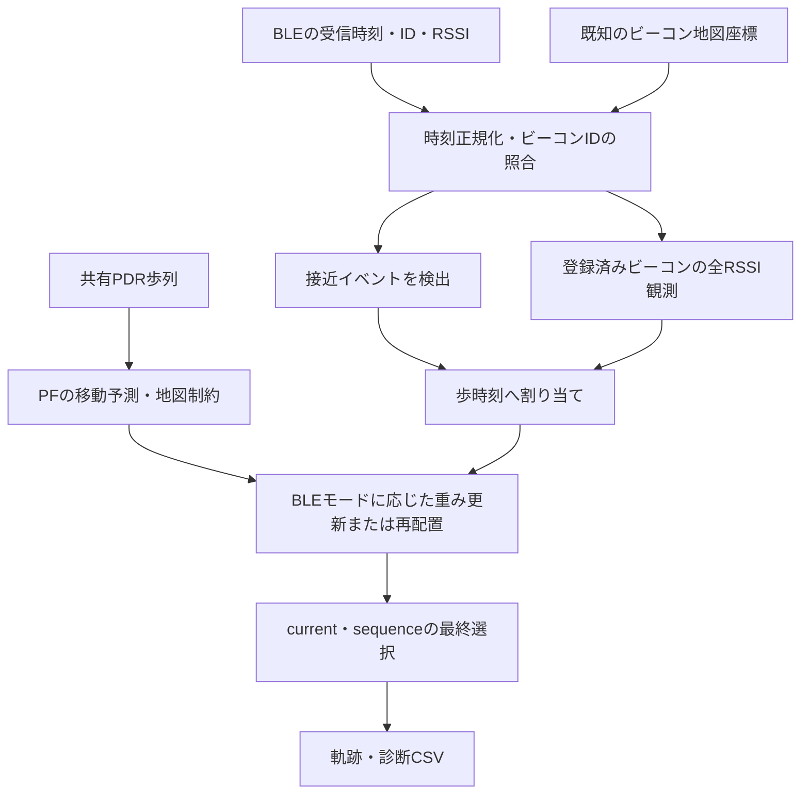

# 現行PFにおけるBLEランドマーク補正

2026-10-22時点のソースに基づく説明。製品コード・設定・既存データは変更していない。
BLE精度の新しい実験は行っていない。1021のCSVと既定ビーコン定義の照合は読み取り専用で確認した。

## 1. 現在使える範囲

|組み合わせ|状態|
|---|---|
|通常PDR＋BLE|実装済み。snap/warp/similarityで位置・軌跡へ反映|
|legacy PF＋BLE|実装済み。以下のPF専用モードを選択可能|
|candidate-bank PF＋実BLE反映|未対応。観測があり、modeがnone以外ならsetupで拒否|
|現在の `uv run rikka particle`|adaptive_peak＋candidate-bank K=8、BLE無効|

BLEは `--ble-landmark` で有効化する。新PFへBLEを統合したわけではない。
`particle/lib/setup.py:43` の制約は、観測が空なら発火しない。
したがって処理が正常終了しても、ビーコン未登録などで補正が一度も効いていない可能性がある。

## 2. PFまでのデータの流れ



PF実行時は通常PDR側のBLE位置補正を無効化し、未補正の共有歩列からPFを実行する。
同じBLEを通常PDRのsnapとPFの重み更新で二重適用する構造ではない。
`--ble-correction snap/warp/similarity` は通常PDRの方式であり、PFのBLEモードとは別。

## 3. 必要な入力と時刻

- 標準形式: `timestamp_s, beacon_id, rssi_dbm`。時刻はセンサーと同じ実験開始基準の秒。
- Thingsup形式: `Timestamp, Device Name, MAC Address, RSSI, Raw Data`。
  `BLE_pos.csv` の端末名・MAC・Raw Data末尾を照合し、内部beacon_idへ変換する。
- Thingsupの絶対時刻はphyphox `meta/time.csv` のSTART情報を優先し、なければ
  `Time Reference.csv` のUnix Offsetから経過秒へ変換する。Android metadataの時刻を使う処理とは別である。
- 地図座標は画像左上原点のpixel値。PFの起点・縮尺・端末姿勢によるY符号に従ってmへ変換する。
- `BLE_pos.csv` の座標未確定端末はランドマークにならない。標準CSVでもIDと既知座標の対応が必要。
- 現loaderが `BLE_pos.csv` に求める必須列は `beacon_id, device_name, mac_address, raw_data_suffix, pixel_x, pixel_y`。標準BLE CSVに組み合わせる場合も、この座標CSVの必須列検査は共通。
- CLIは計測フォルダの大文字 `BLE.csv` を自動選択する。別名は `--ble-data` で明示する。

BLE検出は、その時刻以降で最初の歩へ割り当てる。最終歩より後はPFへ反映しない。
イベントが同じ歩に複数ある場合、登録済みの最後のイベントを使う。
rangingでは同じ歩・同じビーコンの複数観測をRSSI中央値等へまとめ、複数ビーコンは残す。
BLE広告1件ずつをすべて独立な重み更新として掛け続ける設計ではない。

## 4. 「接近イベント」と「全RSSI観測」の違い

### 接近イベント

ビーコンへ近づいた時刻を1件のイベントにする。RSSIが強い受信を検出し、
ラッチした接近区間の移動中央値RSSIのピーク時刻を後から選ぶ。
閾値を超えた最初の時刻へ即座に補正する方式ではない。

|主な設定|既定値|
|---|---:|
|RSSI閾値|-70 dBm|
|同時受信をまとめる幅|0.05秒|
|ラッチ解除|-73 dBm未満が2観測連続|
|RSSI移動中央値|5観測|
|Thingsup形式の最低閾値超過|3観測連続|
|Thingsup形式のピーク条件|局所RSSI変動と閾値からの差が各6dB以上|
|同ビーコンのクールダウン|Thingsup形式では10秒|

**形式による分岐に注意:** 標準3列CSVは互換性のため最低1観測・クールダウン0秒・
最低prominence 0へ緩和する。実測か合成かを内容で判定しているのではない。
実測を標準3列へ変換したデータもこの緩い分岐に入る。

### 全RSSI観測

rangingでは、接近イベントを待たず、既知座標があるビーコンのRSSIを使う。
閾値より弱いRSSIや接近ピーク前の受信も位置仮説の評価材料になる。
イベント検出と全RSSIの系列はpipelineで分離されている。
移動中央値や接近区間終端を使うため、現行はCSV全体を処理するオフラインの実装。

## 5. PFの反映モード

|mode|情報|粒子への作用|位置の直接再配置|
|---|---|---|---|
|none|使用しない|BLE反映なし|なし|
|observation|接近イベント＋既知座標|近い粒子の重み・経路スコアを高める|なし|
|reset|接近イベント＋既知座標|条件を満たすと全粒子をビーコン周辺へ再配置|あり|
|hybrid（既定）|接近イベント＋既知座標|observationとresetを距離・広がりで切り替える|条件次第|
|ranging|全RSSI＋既知座標＋パスロスモデル|RSSIが説明できる粒子の重み・経路スコアを高める|なし|

以下は通常ランドマークの場合。位置・方位を確定する追加設定は別途第8節。

## 6. observation・reset・hybrid

### observation: 「このビーコンの近くを通過した」を使う

粒子位置をx、ビーコン位置をb、距離をdとすると観測スコアは

\[
L(x)=f+(1-f)\exp\left(-\frac{\|x-b\|^2}{2\sigma^2}\right)
\]

既定はσ=1m、下限f=0.05。例として1m離れた粒子は約0.626、3mなら約0.061のスコアになる。
近い候補を相対的に支持し、遠い候補もBLEだけで直ちに完全ゼロにはしない。

地図・歩幅・運動状態を含む既存重みに、このスコアを掛けて正規化する。
経路の累積対数スコアにも反映する。RSSIから算出した距離へ合わせる環状のモデルではなく、
「検出時はビーコン付近」という仮定の位置スコアである。

### reset: 粒子を撒き直す

通常resetは次の処理をする。

1. 補正前の代表位置とビーコンの距離が2mを超えるか確認する。
2. 代表距離が5m以下なら、ビーコン中心・σ=1mの分布から新しい位置を生成する。
3. 地図上の歩行可能点かつ補正前中心から5m以内の候補を受理する。
4. 重みを一様化し、経路スコアを初期化する。

2m以下ではresetを要求せず、5m超では通常resetを警告してスキップする。
最終軌跡でも通常resetの補正辺が5mを超えればRuntimeErrorとする検査がある。確定位置アンカーはこの最終上限検査の対象外。
reset専用モードはobservationの位置スコアを併用しないため、スキップ時に自動でobservationへ切り替わるわけではない。
再配置先の点を検査する処理であり、補正前位置からの線分を通常の歩行辺として検査する処理ではない。

方位補正項・歩幅倍率・運動状態は引き継ぎ、方位driftへ約0.2radの追加ばらつきを入れる。
ビーコンへの変位から歩幅倍率やPDR方位を直接学習・確定する処理ではない。

### hybrid: 重み更新で足りない場合にresetする

代表位置とビーコンの距離をD、補正前粒子群の重み付きRMS広がりをSとして、
通常resetの要求条件は **D>2m かつ D>4S**。さらに実行にはD≤5mを求める。
それ以外は通常observationを使う。D>5mでresetを見送っても、hybridの観測スコアは計算されている。

例えばS=0.5m、D=3mならreset候補になるが、S=2m、D=3mならobservation側となる。
座標が正しいことだけでなく、RSSIピークが本当に接近を表すことが必要。

## 7. ranging: 「このRSSIなら、この距離が妥当」を使う

各粒子からビーコンまでの距離dに対し、期待RSSIを

\[
\hat r(d)=A-10n\log_{10}(\max(d,0.3))
\]

で求め、観測RSSI rとの差を評価する。

\[
L(x)=f+(1-f)\exp\left[-\frac{(r-\hat r(d))^2}{2\sigma_r^2}\right]
\]

既定はA=-59dBm、n=2、σr=6dB、下限0.05。ビーコンごとのモデルを登録していればそれを優先する。
既定モデルの-70dBmは約3.55mに対応するため、最も近い粒子だけでなく、そのRSSIと整合する距離の粒子を支持する。

同じ歩の複数ビーコンでは `exp(α Σlog Lb)`、すなわち `（ΠLb）^α` を掛ける。αの既定は1。
これは複数ビーコンの観測を乗算する実装で、観測の相関や環境変動を完全にモデル化したものではない。
単一ビーコン・単一RSSIから方位や一意な二次元位置が確定するわけでもない。

RSSI→距離の値もデータ型に保存するが、PFのrangingスコアは距離残差ではなくRSSI残差を使う。
粒子位置を直接飛ばすresetを行わず、重みと祖先経路スコアを更新する。
未来のRSSIで既存の祖先経路候補の評価が変わり、最終sequenceの過去部分が変わることがある。
これは過去の粒子位置を自由に移動・最適化するsmootherではなく、保存した祖先経路の選び直しである。
既に失われた通路仮説を重み更新だけで復元できるわけではない。

## 8. 「確定ランドマーク」の特例

`BLE_LANDMARK_ANCHORS` に位置ばらつき `position_sigma_m` を登録すると、
単なるRSSI接近より強い既知情報として扱う。既定の登録は空。

- ranging以外で、代表位置からの誤差が2×position_sigmaを超える、または復旧が必要なら、その位置ばらつきで再配置する。
- 通常resetの5m上限を適用しない。20m超は警告するが、確定情報の反映自体は止めない。
- heading_degもあれば方位補正状態を更新する。双方向設定なら現在方位に近い向きを選び、設定した方位ばらつきを持たせる。
- 位置誤差が小さければ再配置しないことがある。追加設定しただけで毎回必ず位置へ吸着するという意味ではない。
- rangingではこの位置・方位アンカーの強制処理を使わない。

RSSIが強かったことだけを理由に、位置と進行方向が確定したとは言えない。
この設定は通過位置・向きを確実に与えられる場合の追加仮定である。

## 9. 最終軌跡との関係

observationは候補・経路スコアを変えるが、通常のcurrent/sequenceのguardを維持する。
rangingで `--pf-path-selection sequence` を使う場合は、通常の反転数比較によるguardの例外としてsequenceを選ぶ。

resetまたは位置アンカーによる再配置が1歩でもあると、跳躍を許す補正点として記録し、
最終化は `--pf-path-selection` にかかわらずcurrent系となる。物理的な歩行と外部位置補正を区別するためであり、BLE補正のジャンプを実際の1歩距離と解釈しない。

`--pf-landmark-retrofit` は既定無効。確定位置アンカーの直前区間を回転・拡縮する
相似変換候補を作り、地図違反がなければ最終代表経路へ適用する。
全BLE観測・通常resetで必ず働く処理ではなく、前向き粒子群や粒子履歴そのものも書き換えない。
通常PDRのsnap/warp/similarityとは別のPF専用処理である。

## 10. 事前診断と出力の見方

preflightは補正前PDRのビーコン距離とRSSIを照合する。
相関≤-0.5、推定nが1.5〜4.0をPASSの条件とする。既定warnはFAILでも継続し、errorは停止、offは診断を省略する。
この回帰係数でPFのモデルを自動上書きしない。PDR自体の誤差も含む診断なので、PASSを位置精度や実測校正の証明としない。

|出力|確認するもの|
|---|---|
|landmark_corrections.csv|接近イベント時刻・補正前後位置・applied・モード・アンカー情報|
|particle_diagnostics.csv|歩ごとのBLE尤度平均、ESS、復旧モード、位置の広がり等|
|trajectory.csv / step_lengths.csv / step_headings.csv|代表軌跡、PDR由来歩幅・方位。位置再配置を歩幅学習と混同しない|
|pf_trajectory.png|ビーコン配置と経路の対応。自然な見た目は精度保証ではない|

rangingの全RSSI更新は接近イベントのない歩にも発生する。
`landmark_corrections.csv` は検出イベントを中心に記録するため、その行数をrangingの全更新回数とみなさない。
検出のない歩では `landmark_beacon_id` が空欄でも、`landmark_likelihood_mean` に重み更新が記録され得る。

## 11. 今回の1021データの状態

1回目の `ble.csv` は標準3列で200行・3種類のビーコンIDを持ち、形式としては対応している。
一方、既定のビーコン座標定義とのID一致は0件、同フォルダに `BLE_pos.csv` はなかった。
既定座標定義のままBLE pipelineを読み取り専用で呼ぶと、検出0・登録済み測距観測0だった。

このため、当該データへBLEを適用するには次が必要。

1. `--ble-data 'input/1021日計測データ/1021_計測1回目/ble.csv'` で対象を明示する。
2. 実際のbeacon_idと地図上の座標を対応付けた `BLE_pos.csv` 等の登録を用意する。
3. 記録時刻とセンサー開始時刻の整合を確認する。`ble_raw.csv` の単調時計形式をこのBLE loaderが直接使うわけではない。
4. 現状はlegacy PFを指定する。candidate-bankのBLE統合は別の実装・検証を要する。

metadataのBLE configurationに情報があっても、現CLIがそれを自動的にビーコン座標定義へ取り込む処理はない。
標準3列なので、接近イベントの検出はThingsup向けの厳しい条件ではなく互換分岐に入る点も確認が必要。

## 12. 実行例と参照先

既存のBLE対応計測を使う例:

```sh
uv run rikka particle \
  --data-dir input/senser_data_withBLE/natsuki/WithBLE_1 \
  --pf-proposal legacy \
  --ble-landmark \
  --pf-landmark-mode ranging \
  --pf-seed 0 --no-plot
```

この説明のために測位実験を新しく実行したわけではない。コマンドの成功・既存テストの存在と、実測位置精度の確認を区別する。

直近の全体テストは503件成功・8件失敗であり、失敗にはBLEの既定座標・読込2件、
ランドマーク反映4件、従来PF golden2件が含まれる。各モードが実装されていることを、
全テスト成功や実測精度の保証と解釈しない。今回これらの修正・採否判断は行っていない。

主要な参照コード:

- `src/rikka/cli/commands.py`: PDR側補正の無効化とPFへのBLE引き渡し。
- `src/rikka/cli/options.py::_resolve_ble_inputs`: BLE.csv/BLE_pos.csvの選択。
- `src/rikka/ble/lib/loader.py`, `detection.py`, `pathloss.py`, `ranging_check.py`: 入力・検出・RSSIモデル・事前診断。
- `src/rikka/ble/pipeline.py::run_ble_ranging_input`: イベントと全観測の分離。
- `src/rikka/landmark/lib/assignment.py`: 歩への割り当て・中央値集約。
- `src/rikka/particle/lib/propose.py::_resolve_landmark_observation`: モード別BLEスコア。
- `src/rikka/particle/lib/evaluate_map.py`: 通常reset・確定アンカー・状態継承。
- `src/rikka/particle/lib/finalize.py`: reset/ranging時の選択・任意retrofit。
- `src/rikka/particle/lib/setup.py:43`: 新PFとBLE観測の併用禁止。

一部のdocstringに「将来PFで使用」とあるが、実コードでは既にPFから呼ばれている。
本書はそのコメントではなく現在の呼び出し経路を基準とした。
