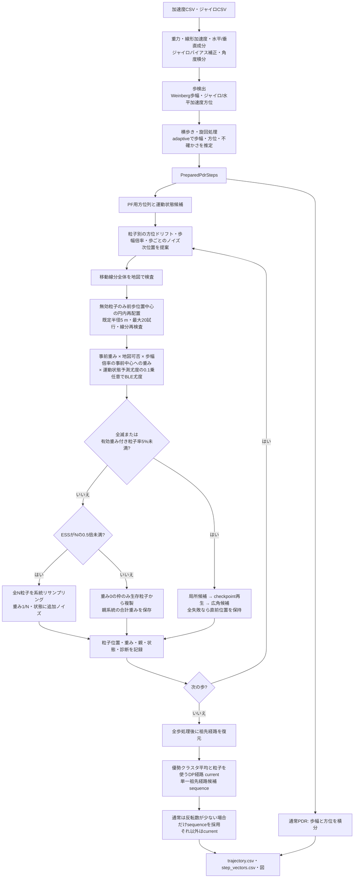

# 屋内PDR・地図制約付きPFの現状実装調査

調査日: 2026-10-22（日本時間）  
対象: `309-FixParticleFilter`、HEAD `ab3ec3490c2fd651287789b897aec8e3ccf3ded9`  
調査開始時の追跡対象・未追跡差分: なし。

本調査では製品コード、パラメータ、実験データ、既存成果物を変更していない。このレポートだけを新規作成した。実データの再実行・新しい比較実験は行っていない。以下の行番号は上記HEADのもの。リンク先はリポジトリルートからの実装パスに対応する。

**主要な結論:** 壁衝突時の円内再配置は、PDRの方向・歩幅と無関係な位置候補を作る。再配置後の実変位と粒子の内部方位・歩幅状態の不一致を解消する処理はなく、その差への尤度もない。また、最終出力は単純な全粒子平均ではなく、優勢クラスタ平均と祖先粒子を使った経路選択である。この経路選択は壁非交差を検査する一方、歩ごとの距離・速度・加速度の上限を設けない。したがって、跳ね返り・ジャンプ・短縮を説明する仕組みは存在するが、ユーザーが見ている特定区間の主因・寄与率は未確定である。

## ① 現在の処理フロー



BLE検出がある場合は、地図制約解決時に位置reset・確定アンカー処理が上記通常分岐より優先される。BLE resetが実行された歩では、代表軌跡選択の壁交差検査を例外化する。上図はBLEなしの主要経路を示す。

入口と順序: [`preparation.py`](../src/rikka/pdr/lib/preparation.py) `prepare_pdr_steps_with_settings()` L124–199、[`particle/pipeline.py`](../src/rikka/particle/pipeline.py) `run_particle()` L143–176、[`runner.py`](../src/rikka/particle/lib/runner.py) `run_particle_steps()` L222–252、[`evaluate_map.py`](../src/rikka/particle/lib/evaluate_map.py) `resolve_map_constraints()` L371–403。

### 当初の理解との照合

| 当初の理解 | 現在のコードとの対応 |
|---|---|
| PDRで歩幅・方位を推定 | 一致。ただし生のWeinberg値だけでなく、運動状態処理・適応推定を通った共有歩列を使う。 |
| PDRの移動結果にPFの地図制約を適用 | 概念上は近い。実際には完成したPDR座標列を逐点修正する方式ではなく、共有の歩幅・方位・不確かさを使い、PFが独立に粒子位置を伝播する。PF用方位の連続化も存在する。 |
| 壁内粒子の重みを0 | 一部一致。まず無効遷移を円内再配置で救済し、救済後も無効な粒子だけ地図因子0となる。壁内終点だけでなく壁を横切る線分も対象。 |
| 衝突粒子は前回位置中心の円内に一様再配置 | 一致。中心は各粒子自身の前歩位置。前回の代表推定位置ではない。候補は面積一様、採用点は地図で条件付けられる。 |
| 残った全粒子の加重平均が推定位置 | 不正確。優勢な到達可能クラスタ内の加重平均を候補とし、合法な粒子経路との組合せを選ぶ。条件によって単一祖先経路を採用する。 |
| 各時刻の推定点を連結 | 出力は点列だが、各歩で独立確定して連結する処理ではない。全歩終了後、履歴・親情報・地図を使って最終経路を選ぶ。 |

## ② 実装の調査結果

### A. PDRの移動モデル

#### A1. 歩幅

既定は `STEP_LENGTH_METHOD="weinberg"`。基本式は

\[
L_k=K(\max a_v-\min a_v)^{1/4},\qquad
K=0.47\,h/1.70
\]

である。`a_v` は線形加速度の重力方向への射影。最初の推定は検出ピーク前後50サンプルの窓を使う。欠損で窓内に値がなければ0を返す。身長 `h` は設定・引数に依存する。

- [`sensors.py`](../src/rikka/common/lib/sensors.py) `process_sensor_data()` L104–153: 重力推定、線形加速度、`v_acc`、水平成分。
- [`step_length.py`](../src/rikka/pdr/lib/step_length.py) `estimate_step_length()` L65–81。
- [`config/__init__.py`](../src/rikka/common/config/__init__.py) L106–128: 身長係数・窓・方式。

最終的なPDR歩幅はこの値に常に等しいわけではない。横歩き・旋回の倍率処理後、接地区間に基づく別の歩幅観測と品質を作り、既定の `adaptive` が対数歩幅スケールを更新して混合分布の平均歩幅を返す。`forward` という水平加速度射影の二重積分方式もあるが、既定ではない。

- [`trajectory.py`](../src/rikka/pdr/lib/trajectory.py) `_collect_raw_steps()` L45–97、`_resolve_motion_steps()` L100–161。
- [`step_length.py`](../src/rikka/pdr/lib/step_length.py) `build_step_length_observation()` L84–161: 区間振幅、周期、品質、対数歩幅標準偏差。
- [`fusion/adaptive.py`](../src/rikka/pdr/lib/fusion/adaptive.py) `_adaptive_length_state()` L162–202、`estimate_adaptive_pdr()` L406–424。

#### A2. 方位

ジャイロx軸から推定バイアスを引き、実時刻差で積分して平滑化する。歩の中点でサンプリングした角度へ初期方位を加える。一方、水平加速度の `h_y,h_z` をジャイロ角で世界座標へ回転し、歩区間内で両端速度を補正して二重積分し、変位の `atan2` から移動方向を得る。

既定 `gyro_accel_motion` は信頼度が閾値以上なら移動方向、それ以外はジャイロ方位を候補に使う。その後の身体方位推定、横歩き・旋回分類、方位ソース選択、適応推定を通った値が共有歩列となる。前進用ソースの既定は `body`。

- [`sensors.py`](../src/rikka/common/lib/sensors.py) L156–176。
- [`heading/resolver.py`](../src/rikka/pdr/lib/heading/resolver.py) `_select_heading_candidate()` L38–62、`resolve_step_heading()` L123–150。
- [`heading/motion.py`](../src/rikka/pdr/lib/heading/motion.py) `_integrate_motion_with_zero_velocity()` L66–88、`_motion_result_from_samples()` L91–155。
- [`trajectory.py`](../src/rikka/pdr/lib/trajectory.py) L100–160、[`fusion/adaptive.py`](../src/rikka/pdr/lib/fusion/adaptive.py) `_adaptive_heading_state()` L122–159。

**PFへの入力方位にも追加処理がある。** `build_particle_motion_headings()` は横歩きと直後2歩などで移動方位を選択し、実旋回と判定していない歩では方位変化を25度、横歩き系なら45度に制限する。したがって、通常PDRとPFの基準方位列は同一とは限らない。

根拠: [`motion_state/evidence.py`](../src/rikka/pdr/lib/motion_state/evidence.py) `build_particle_motion_headings()` L219–274。

#### A3–A7. 粒子の伝播、分布、バイアス、PDRの拘束強度

通常提案では、概略として各粒子 `i` を次のように動かす。

\[
d_k^i=\operatorname{wrap}(0.85d_{k-1}^i+\epsilon_\theta^i)
\]
\[
s_k^i=\operatorname{clip}(1.03+0.995(s_{k-1}^i-1.03)+\epsilon_s^i)
\]
\[
\theta_k^i=\theta_{\text{state},k}^i+c_{k-1}^i+d_k^i,
\quad \ell_k^i=\max(0,L_{\text{state},k}^i s_k^i(1+\epsilon_L^i))
\]
\[
p_k^i=p_{k-1}^i+\ell_k^i(\cos\theta_k^i,\sin\theta_k^i)
\]

| 項目 | 現在の処理・既定値 | 根拠 |
|---|---|---|
| 初期位置 | 全粒子 `(0,0)`、重み `1/N`。起点自体を位置分散させない。 | `initialize.py` L61–75 |
| 初期方位 | `heading_drift ~ Normal(0,0.26 rad)`。`heading_correction=0`。 | 同 L65–68 |
| 歩ごとの方位誤差 | 正規分布。σは `max(0.14 rad, 0.15×posterior.heading_std)`。wrapで角度を正規化。 | `propose.py` L148–166 |
| 初期歩幅倍率 | `Normal(1.03,0.10)`を通常 `[0.80,1.30]` にclip。 | `initialize.py` L69–74、設定 L174–183 |
| 歩幅倍率の時間発展 | 中心1.03へ弱く回帰、保持率0.995、正規過程ノイズの基本σ=0.010。 | `propose.py` L168–192 |
| 歩ごとの歩幅誤差 | `1+Normal(0,0.01)`を乗算し、負の歩幅は0にclip。 | 同 L208–217 |
| 適応による拡張 | 記録内に歩幅の相対不確かさ18%以上の歩があれば、倍率範囲を少なくとも `[0.6,1.5]`、初期σを少なくとも0.12に広げる。過程ノイズも歩ごとに拡張する。 | `setup.py` L139–159、`propose.py` L168–192 |
| 運動状態 | 前進・左横歩き・右横歩き・旋回の離散状態を、状態遷移×観測尤度から確率抽出。 | `proposal.py` L30–61 |
| 状態別方位・歩幅 | 校正信頼度0.85以上、または横歩きクラスタなしなら状態間で基準値を共通化。それ以外は身体方位・左右方向など、状態別の方位と歩幅倍率を使う。 | `proposal.py` L64–101、`propose.py` L193–207 |
| 永続状態 | `heading_correction`、減衰する `heading_drift`、永続的な `stride_scale` を保持。初期に固定の非ゼロ方位バイアスは与えない。歩幅には中心1.03の明示的な事前偏りがある。 | `initialize.py` L65–84、`propose.py` L147–192 |

上表のパスはすべて `src/rikka/particle/lib/` 配下、定数は `common/config/__init__.py` L168–202。

通常提案はPDRを中心にするが、厳密な拘束ではない。方位・歩幅候補に幅があり、状態選択もある。さらに円内再配置はこの提案を全面的に置き換えられる。初期方位差は減衰状態であり、全歩で固定される恒久方位バイアスとは異なる。

### B. 壁制約

| 調査項目 | 実際の処理・注意点 | ファイル・関数・行 |
|---|---|---|
| B1 壁の定義 | 画像を0–255のグレー値へ正規化。RGBは先頭3色の平均。`>128` の画素だけ歩行可能。128ちょうども不可。 | [`common/lib/floormap.py`](../src/rikka/common/lib/floormap.py) `normalize_floormap_gray()` L60–69、`is_walkable_cell()` L54–57 |
| B2 経路全体 | 始点・終点を画素座標へ変換し、supercoverで線分が通るセルを調べる。両端が通路でも途中に壁があれば不可。 | [`map_constraints.py`](../src/rikka/particle/lib/map_constraints.py) `_evaluate_particle_transitions()` L42–82 |
| B3 衝突重み | 円内再配置後の可否を0/1として掛ける。救済成功粒子は無効提案だったことを理由にはゼロ化しない。 | [`propose.py`](../src/rikka/particle/lib/propose.py) L218–275、[`weighting.py`](../src/rikka/particle/lib/weighting.py) `weight()` L16–33 |
| B4 位置修正 | 衝突点へ反射したり壁面に沿って投影する方式ではない。円内候補への置換、死亡枠の複製、集団復旧がある。最近傍通路へsnapするhelperは定義されているが、今回追った通常実行経路は呼ばない。 | `relocate.py` L40–89、`evaluate_map.py` L53–112、`recovery/apply.py`、`map_constraints.py` L85–139 |
| B5 接近ペナルティ | 通常の地図因子は二値。壁までの距離による連続ペナルティや人体半径のclearanceはない。壁に近いだけでは減点しない。 | `weighting.py` L25–32、`floormap.py` L54–57、L88–142 |
| B6 座標変換 | `px=origin_x+x/scale`、`py=origin_y+y_sign*y/scale`。`scale`はm/px、既定0.01。`y_sign`は平均重力 `gx_mean,gz_mean` の大小と符号で決まる。変換自体に任意回転はない。初期方位はPDR側で適用する。 | `floormap.py` `pixel_y_sign()` L18–22、`compute_pixel_coords()` L25–35、逆変換 L38–51 |
| B7 境界と許容 | セルは `floor(coord+0.5)`。画像外・非有限値は不可。角を通ると両側セルも検査する。交差時刻の同時判定許容は `1e-12`。実距離での壁侵入許容や壁の膨張処理はない。 | 同 `segment_crosses_only_walkable_cells()` L95–142 |

壁制約は「画像上で通れる」という判定であり、歩幅・時間に対して物理的に妥当な移動であることを保証しない。また、しきい値、画像のアンチエイリアス、座標登録・縮尺のずれが判定を変える。

### C. 再配置・リサンプリング・集団復旧

**以下の3処理は別物で、同じ歩の中で組み合わされ得る。**

#### C1. 壁衝突提案を円内へ再配置する処理

- 実行条件: 通常の提案線分が無効。重みを掛ける前に実行する。
- 中心: `previous_particles[pending_indices]`。各粒子自身の前歩位置。
- 既定半径: **5.0 m**、最大20回。現在の設定を直接確認した値であり、過去の3 m試用記録を現在値として扱っていない。
- サンプリング: 角度 `Uniform(0,2π)`、半径 `R√Uniform(0,1)`。円の面積に対して一様。
- 採用条件: 前歩位置から候補位置までの線分全体が歩行可能。初めて成功した候補を採用する。採用後の分布は、円内一様分布を地図の可視領域で条件付けたものとなる。
- PDR情報: 歩幅・方位はこの関数への引数にもなく、候補点生成や採用評価には使わない。
- 状態・重み: 位置と可否だけを置き換える。`proposed_drift`、`proposed_stride_scale`、運動状態は新しい変位に合わせて更新しない。元の提案粒子に対応する状態を引き継ぎ、通常の重み計算へ進む。
- 失敗: 20回とも不成立なら元の無効提案と無効判定を保持し、その後地図因子で重み0となる。

根拠: [`relocate.py`](../src/rikka/particle/lib/relocate.py) `_sample_uniform_disk()` L23–37、`relocate_invalid_particles()` L40–89、[`propose.py`](../src/rikka/particle/lib/propose.py) L227–275、[`config`](../src/rikka/common/config/__init__.py) L189–193。

半径5 mは5 m移動の強制ではないが、1歩で0〜5 mの移動を許す。障害物がない円全体なら `E[r]=2R/3≈3.33 m`、平均変位ベクトルは0となる。これは分布の解析値であり、壁のある現場での実測平均ではない。

#### C2. 重みに応じた通常リサンプリング

事後重みは次式であり、正規化前の値からESSを計算する。

\[
\widetilde w_i=w_{i,\text{before}}\,I_{\text{map},i}\,
\exp\left[-\tfrac12((s_i-1.03)/\sigma_s)^2\right]
\,Z_i^{0.1}\,L_{\text{BLE},i}
\]

BLEなしでは最後の因子はない。`motion_posterior` がなければ歩幅倍率因子は1。`σ_s=clip(1.5×相対歩幅不確かさ,0.1,0.3)`。`Z_i` は運動状態遷移と観測から得た予測尤度である。**このガウス因子が比較するのは歩幅倍率と事前中心であり、再配置後の実移動距離とPDR歩幅の差ではない。**

根拠: `propose.py` L254–298、`proposal.py` L45–61、`weighting.py` L16–33。

| 項目 | 現在の処理 |
|---|---|
| タイミング | 地図・円内再配置・各尤度の計算後、集団復旧が不要なら実行する。 |
| ESS | 正規化重み `w` に対して `1/Σw²`。`ESS < 0.5N` で全体更新。閾値ちょうどは全体更新しない。既定500粒子なら250未満。 |
| 全体更新 | 系統リサンプリングで全N個の親を抽出。累積重みに共通の一様オフセットを使い、重み0の境界を `searchsorted(side="right")` で避ける。生存粒子も複製・脱落する。 |
| 全体更新後の重み | 全粒子 `1/N`。位置、方位状態、歩幅状態、運動状態を抽出親からコピーする。 |
| 高ESS時 | 重み0の枠だけ生存粒子から系統抽出で補充する。生存枠の位置と親は維持。死亡枠もなければ親はidentity。 |
| 部分補充後の重み | 親の正規化重みを「元の生存枠＋複製先」の数で等分。親系統全体の合計重みを維持する。一律1/Nにはしない。 |
| 追加ノイズ | 位置ジッタは与えない。全体更新では全枠、部分補充では補充枠だけ方位ドリフトと歩幅倍率に正規ノイズ。高信頼記録では方位σを既定0.12 radから最大4/9倍まで縮小。歩幅倍率σは通常0.015、適応時は少なくとも0.02。 |
| 親情報 | `parent_indices=indices` を保持し、各歩の `parent_history` へ記録する。 |

根拠: [`evaluate_map.py`](../src/rikka/particle/lib/evaluate_map.py) `_resample_or_keep()` L53–112、[`resampling.py`](../src/rikka/particle/lib/resampling.py) L16–38、[`initialize.py`](../src/rikka/particle/lib/initialize.py) L39–58、L145–147、[`record.py`](../src/rikka/particle/lib/record.py) L73–85。

#### C3. 全滅・生存率低下時の集団復旧

円内再配置の後でも事後重み総和が0、または `valid_transition & (weights_before>0)` の割合が5%未満なら、通常のESS分岐より集団復旧を優先する。

1. 局所グリッド: 基準方位に0、±5、±10、±20、±30、±45度、歩幅倍率 `[1,0.9,1.1]`。歩幅適応が有効な条件では `[1,0.85,0.7,1.15,1.3]`。旋回・横歩きなどの根拠があると広角候補も許す。
2. checkpoint再生: 局所復旧に失敗すると、完了歩との差が1〜3歩の健全checkpointを探し、そこから現在歩までを再生成する。過去の粒子履歴・親・重み履歴も置き換える。
3. fallback: 広角候補を許して再試行する。±60、±90、±135、180度の後退候補も存在する。
4. 全失敗: `failed_hold` として位置・方位状態・歩幅状態・重みを直前の値に戻し、移動量0を記録する。

成功した復旧では重みを1/Nへ戻す。局所復旧の選択には方位差と歩幅倍率差の二乗コストを使い、`exp(-cost/2)` と親重みから候補を選ぶ。通常既定の `preserve_recovery_branches=False` では枝quotaを使わず、局所段に有効候補があればその段で返す。回避角は `heading_correction` ではなく `heading_drift` に加わり、後続歩へ保持率0.85で伝播する。

根拠: `propose.py` L299–302、`evaluate_map.py` L391–403、[`recovery/local.py`](../src/rikka/particle/lib/recovery/local.py) L59–69、L124–239、[`recovery/apply.py`](../src/rikka/particle/lib/recovery/apply.py) L25–126、L129–213、L216–300、[`runner.py`](../src/rikka/particle/lib/runner.py) L139。

### D. 推定位置・軌跡の生成

| 調査項目 | 実際の処理 | 根拠 |
|---|---|---|
| D1 平均計算の時点 | 最終代表軌跡用の平均は全歩終了後の `finalize()` から計算する。歩ごとの診断やBLE処理にも別途平均があるが、それ自体が最終軌跡ではない。 | `runner.py` L247–252、`finalize.py` L85–195 |
| D2 平均の対象 | 正重み粒子を、重み最大のseedから直線到達できる集合へ貪欲に分割し、合計重み最大の集合を採る。全粒子ではない。集合内の全ペアが相互可視である保証もない。 | `path_history.py` `_dominant_reachable_cluster()` L40–82 |
| D3 正規化 | 通常更新時に重み総和で正規化し、クラスタ内でもその重み総和で再正規化して平均する。 | `evaluate_map.py` L57、`path_selection.py` L69–75 |
| D4 再標本化との前後 | 位置・重み履歴は再標本化または復旧後に記録する。したがってクラスタ平均はその後の粒子・重みに基づく。全体再標本化による有限標本の平均変動を受け得る。 | `runner.py` L247–251、`record.py` L75–85 |
| D5 平均が壁内に入るか | 計算した候補平均が壁内になる可能性は排除されないため、実際に点の歩行可否を検査する。通常は無効平均を採用せず粒子fallbackを選ぶ。最終線分も検査する。 | `path_selection.py` L76–86、L88–183、L208–227 |
| D6 連続性 | 前時点平均・粒子から現在平均への線分、前時点平均から現在粒子への線分、親系統を使うDPがある。一方、距離・速度・加速度やPDR歩幅差をDPの遷移コストに入れていない。 | 同 L106–179 |
| D7 短縮の仕組み | 異方向の移動の平均、重みやクラスタ構成の変化、粒子fallbackとの切替で代表点変位が変わる。円内再配置は距離も変更する。復旧の短い歩幅候補、失敗時保持も短縮要因になる。 | `propose.py` L227–249、`path_selection.py` L59–75、L142–179、`recovery/local.py` L65–69、`recovery/apply.py` L252–266 |
| D8 祖先・履歴 | 親履歴を保存し、終端粒子ごとに逆追跡する。currentのDPも祖先を使い、sequenceでは単一祖先経路候補を評価する。 | `record.py` L84、`path_history.py` L19–37、`finalize.py` L85–195 |

上表のPFファイルはすべて `src/rikka/particle/lib/` 配下。

#### 最終経路の2方式と選択条件

- **current:** 各時点の優勢クラスタ平均を優先し、平均が不適切なら祖先粒子点を使うDP。平均への遷移は壁を通らなければ許され、距離自体に罰則はない。粒子点には平均からの二乗偏差とクラスタ外の大きなペナルティが付く。単一の物理的粒子を常に追う方式ではない。
- **sequence:** 累積対数スコアに、センサー上の旋回根拠がない反転1回につき `log(0.1)` を加え、合法な単一祖先経路を選ぶ。反転判定には135度、直近5歩などの条件がある。
- 既定 `PF_PATH_SELECTION="sequence"` でも、通常はsequenceの反転数がcurrentより**厳密に少ない場合だけ**採用する。同数ならcurrent。rangingではsequenceを採用する。BLE reset/位置アンカー実行時はcurrentを使う別分岐となる。

根拠: [`path_selection.py`](../src/rikka/particle/lib/path_selection.py) L88–179、[`sequence_path.py`](../src/rikka/particle/lib/sequence_path.py) `_unsupported_reversal_count()` L19–76、`_select_sequence_map_path()` L79–149、[`finalize.py`](../src/rikka/particle/lib/finalize.py) L85–195。

**出力上の注意:** PFの `step_lengths.csv` は入力の決定論的歩幅 `sl_det` を保存する。最終代表軌跡の各線分長ではない。実際の出力距離は `trajectory.csv` の差分または `step_vectors.csv` と照合する必要がある。診断の `effective_step_length_mean_m` は親対応の粒子実変位平均であり、代表軌跡の線分長とも異なる。

根拠: `record.py` L81、`finalize.py` L228–233、[`plot/pipeline.py`](../src/rikka/plot/pipeline.py) `write_outputs()` L58–73、[`diagnostics.py`](../src/rikka/particle/lib/diagnostics.py) L85–95。

任意の事後履歴修正候補 `history_candidate` も存在するが既定は無効で、通常の `trajectory` を置き換えない。候補は別CSVへ保存する。候補生成には移動量二乗の正則化があり、短縮とのトレードオフがあるため、通常PFの経路と区別が必要。

根拠: [`particle/pipeline.py`](../src/rikka/particle/pipeline.py) L120、L187–205、L224–231、[`history_correction.py`](../src/rikka/particle/lib/history_correction.py) L90–105、[`plot/lib/history.py`](../src/rikka/plot/lib/history.py) L32。

## ③ 問題の原因分析

判定は「コードでその作用を確認できるか」と「対象の実軌跡で症状の主因と確認できたか」を分ける。今回の既存テスト通過は実環境での精度・症状不存在を意味しない。

| 仮説 | 判定 | コードで確認した根拠 | 未確認の範囲 |
|---|---|---|---|
| 1 円形一様再配置による方向喪失 | **確認済み（再配置時の方向情報喪失）** | `relocate.py` L23–37、L71–86は方位・歩幅を使わず位置を置換。逆方向・横方向も地図上で合法なら許す。`propose.py` L254–275は実変位との残差を重みに使わない。 | 特定の最終軌跡の跳ね返りが再配置由来であること、発生回数・寄与率は未確認。 |
| 2 加重平均による短縮 | **可能性あり** | `path_selection.py` L69–75で複数の位置を平均する。方向の異なる移動は平均ベクトルが短くなり得る。クラスタ選択・重み変化・fallback切替も作用する。 | 対象軌跡の短縮が平均化に由来するか未確認。sequence採用区間には同じ説明をそのまま適用できない。平均化で必ず短縮するわけでもない。 |
| 3 壁制約による分布の偏り | **可能性あり** | 無効線分の重み0化と、地図で条件付けた円内再配置は、壁と反対側などへ分布を偏らせ得る。優勢クラスタ交代も代表点を動かす。`weighting.py` L25–30、`relocate.py` L75–86、`path_history.py` L78–82。 | 再配置で大部分が救済される場合、単なる粒子削除だけが主因とはいえない。特定区間の偏りと跳ね返りの対応が必要。 |
| 4 頻繁なリサンプリングによる多様性喪失 | **可能性あり** | 低ESS全体更新と死亡枠補充は複製を作る。位置に追加ノイズはなく、親系統数が減る可能性がある。`evaluate_map.py` L60–111。 | 毎歩の全体更新ではない。状態への追加ノイズもある。発動頻度・祖先縮退・位置集中が対象症状を起こした証拠は未収集。 |
| 5 PDRと地図補正の不整合 | **確認済み（内部状態と実変位の不整合）** | 円内再配置は位置だけを変更し、保持する方位・歩幅倍率を変位に合わせない。実変位は診断に使うだけ。`propose.py` L227–265。局所復旧では回避角をドリフトに持ち越す。`recovery/local.py` L213–233。 | 地図による補正自体はPFの目的であり、その存在だけでは不具合とはいえない。対象症状に対する具体的な寄与は未確認。 |

### 跳ね返り・ジャンプを説明できる範囲

鏡面反射のような壁での反射計算は存在しない。それでも次の連鎖で見かけ上の跳ね返りを説明できる。

1. PDR提案が壁へ向く。
2. 壁に向かった粒子が、前歩位置中心の円の通路側へ再配置される。後退点も候補になる。
3. 位置の変更に対して内部の進行方向が追従しないため、次歩も壁へ向かう提案を繰り返し得る。
4. クラスタ重み・代表候補が変化する。DPは合法な線分であれば長い移動も許すため、点列が後退・横移動・大きな位置飛びを示し得る。

根拠は `relocate.py` L71–86、`propose.py` L153–217、L227–275、`path_selection.py` L115–140、L156–179。加えて、集団復旧には明示的な180度候補と回避角の持越しがある。BLE有効時はreset・アンカーという別のジャンプ要因も確認する必要がある（`evaluate_map.py` L115–172、L193–264）。

### 短縮を説明できる範囲

平均による短縮は数学的に説明できる。例として同じ起点から2粒子がそれぞれ1 m、±60度へ動くと、等重み平均の移動は0.5 mとなる。これは現場データの再現結果ではなく、現行平均処理に適用可能な説明例である。

重みと所属粒子が同じ場合でも `||Σw_i Δp_i|| ≤ Σw_i ||Δp_i||`。実際には重みとクラスタ構成も変わるため、平均位置の差には再重み付けによる移動も含まれ、短縮に限らず逆行や伸長も生じ得る。最終点間距離を個々の粒子歩幅と同一視できない。

ほかにも、復旧の短い歩幅候補、`failed_hold`、PDR段階の歩幅補正がある。**円内再配置は短縮専用の機構ではなく、5 mまでの移動によって伸長も起こし得る。** したがって「全短縮は加重平均が原因」とは現時点で断定できない。

## ④ 改善案の比較

以下は構造上の実装可能性の評価であり、変更・パラメータ比較は実施していない。難易度は現在のコードに対する相対評価。

| 改善候補 | 現状・変更対象 | 期待できる効果 | デメリット・注意点 | 難易度・影響 |
|---|---|---|---|---|
| 1 衝突粒子を生存粒子から複製 | **部分的に実装済み**。円内救済後に残る死亡枠には `_resample_or_keep()` が実施。円内救済に先行・代替させるなら `propose()`→`relocate_invalid_particles()` の呼出方針と `resolve_map_constraints()` を変更する。 | PDRに沿って合法に進んだ粒子へ質量を寄せ、方向無関係な再配置を減らせる。 | 生存候補が少ないと誤枝へ早く集中。全滅時は複製元がない。複製は死亡枠の旧位置からの物理移動ではなく親の変更として扱う必要がある。 | 中。復旧条件、乱数列、親履歴の検証が必要。 |
| 2 歩幅・方位へ確率誤差 | **実装済み**。`propose()`、`proposal._sample_motion_states()`、`_motion_state_headings()`。 | PDRを厳密に強制せず、多様な運動候補を保持できる。 | 独立ノイズだけでは長期バイアスや複数通路仮説を十分表せない。広げ過ぎると誤枝・拡散が増える。 | 現状評価は低。相関・混合・ノイズ構造の再設計は中。 |
| 3 PDR中心分布＋広域一様分布 | **未実装**。通常提案と円内救済はあるが、救済候補内部で混合比を用いる分布ではない。`relocate_invalid_particles()`、`propose()`、必要なら `weight()` を変更。 | 進行方向付近の修正と、PDRが大きく外れた場合の探索を両立。 | 一様成分に移動モデルの裏付けがないと現在と同様の大ジャンプを残す。壁での棄却を含む提案分布の扱いが難しい。 | 中〜高。成分ラベル、提案密度、内部状態との整合性を設計する。 |
| 4 歩幅誤差のシグモイド・ガウス重み | **倍率事前へのガウス型重みは既存**。実移動距離残差への重みはない。`propose()` L254–275、`weighting.weight()`、経路スコアを変更候補とする。 | 再配置後の極端な変位を軟らかく抑えられる。 | 同じPDR情報の二重計上、誤ったPDRに戻す過拘束、停止・横歩きの抑圧に注意。シグモイドは絶対残差などの定義が必要。 | 中〜高。まず確率モデルと何を独立観測とするかを整理する。 |
| 5 ESSによる適応再標本化 | **実装済み**。`_effective_sample_size()`、`_resample_or_keep()`、既定比率0.5。 | 不要な全体更新を減らす。 | ESSが高くても空間的な分岐や祖先多様性が失われている場合がある。死亡枠補充は高ESSでも実行される。 | 追加実装不要。閾値以外の指標評価は低〜中。 |
| 6 平均以外の位置推定 | **粒子fallback・単一祖先経路は既存**。追加なら `path_selection.py`、`sequence_path.py`、`finalize()`。 | 多峰分布の中間点を避ける。MAP粒子・medoid・経路全体の推定などを比較可能。 | 単時点MAPは切替ジャンプを起こせる。祖先経路も円内再配置由来の非現実的移動を引き継ぐ。平滑化は短縮を増やし得る。 | 中〜高。距離・旋回・多峰性の扱いが必要。 |
| 7 祖先を使った軌跡復元 | **実装済み**。`_reconstruct_particle_paths()` とsequence選択。拡張なら `path_history.py`、`sequence_path.py`、`finalize()`、復旧履歴処理。 | 親子の整合性を使い、独立した代表点選択の揺れを減らせる。 | 終端まで生き残った系譜しか復元できず、過去に消えた正しい枝は戻せない。オンライン出力には遅延・固定ラグの検討が必要。 | 現状の利用確認は低。平滑化・固定ラグ・枝保持の拡張は高。 |
| 8 方位バイアス・歩幅倍率を状態推定 | **歩幅倍率は実装済み、方位も部分的に既存**。`heading_correction` と減衰ドリフトはあるが、通常伝播で方位補正をランダムウォーク学習しない。`initialize()`、`propose()`、`_resample_or_keep()`、`recovery/*`、`state.py`、診断・履歴を検討。 | 長期的なセンサーバイアスと一時的な壁回避を分離できる。 | 地図だけでは方位偏差・歩幅・誤枝・起点ずれを識別できない場合がある。一時回避を恒久バイアスとして学習すると誤補正が残る。 | 中〜高。状態分離と識別可能性の検証が重要。 |

### PDR情報の二重計上について

「提案に使った情報を重みに使うと必ず二重計上」でも、「尤度を追加すれば常に正しい」でもない。

一般に、提案分布 `q` と目標分布の遷移モデル `f`、独立観測尤度 `g` の関係は、概念的には `w_new ∝ w_old × f × g / q` となる。PDRに基づく提案がそのまま遷移モデルであれば、同じ歩幅のガウス密度を独立尤度として追加すると分布を必要以上に鋭くし得る。一方、広域成分を混ぜた提案に対して目標の遷移モデルとの比を補正する設計は、同じ情報の単純な再乗算とは異なる。

現行の運動状態提案は `T[前状態,次状態]×観測尤度` を正規化して抽出し、正規化定数 `Z_i` を返す。その予測尤度を重みに反映する構造自体は、観測を使った提案の補正として説明できる。ただし現在は `Z_i^0.1` と弱めてあり、PDRの適応推定にも関連センサー情報を使う。厳密な事後分布や独立性を保証した実装と断定しない。

特に円内救済は衝突したときだけ提案を切り替え、変位に対する `f/q` を計算していない。歩幅残差重みを足す前に、これを「復旧用のヒューリスティック」とするか、混合遷移モデル／混合提案として定義するかを決める必要がある。歩幅倍率を事前中心へ寄せる現在の因子も、独立した実測歩幅の観測尤度とは区別する。

ここでの式は実装の検討に用いる数学的説明であり、現在のコードが完全な重要度補正を行っているという主張ではない。対応箇所は `proposal.py` L45–61、`propose.py` L254–292、`weighting.py` L25–32。

## ⑤ 優先的に検証すべき項目

以下は**次回以降の提案であり、今回未実施**。実データ・正解経路・座標登録・判定基準を合意してから実行する。まず現行条件の読み取り診断を行い、設定比較は別途承認された範囲で行う。

| 優先度 | 検証 | 固定条件・観測内容 | 切り分けること |
|---|---|---|---|
| 1 | 症状区間の処理段階を特定 | 対象CSV・seed・起点・初期方位・縮尺・BLE条件を固定。壁判定前提案、救済前後、重み前後、再標本化後、最終代表軌跡を歩番号・実時刻で重ねる。 | 粒子伝播から飛んでいるのか、円内再配置なのか、代表点選択だけが飛ぶのか。 |
| 2 | 再配置の実変位と状態の不整合を測定 | 粒子ごとに再配置フラグ、親位置、救済前後位置、実移動距離、`atan2(実変位)`、`theta`、PDR歩幅、前後重みを記録する。 | 方向喪失・後退・過大移動が代表点変化にどの程度影響するか。 |
| 3 | 長さを4段階に分解 | 共有PDRの歩幅合計、親対応の粒子実変位、current/sequenceそれぞれの線分長、最終採用軌跡長を比較。区間別・歩別にも確認する。 | PDR自体の過小歩幅、粒子移動の短縮、平均・クラスタ切替による短縮を分離する。 |
| 4 | ESSと祖先多様性の関係 | 更新前後ESS、全体/部分更新、unique parent/position、複数歩前の祖先数、空間spread、枝別重みを確認。複数seedで再現性を見る。 | 高ESSと多様性維持を混同せず、リサンプリング由来の集中を診断する。 |
| 5 | 集団復旧・代表経路選択を診断 | `recovery_mode`、回避角、歩幅倍率、checkpoint書換範囲、`trajectory_mode/source_index`、current/sequenceの反転数を症状と対応付ける。 | 局所回避・後退・履歴再生・平均/粒子切替の影響。 |
| 6 | 地図登録とPDR入力を確認 | 正解の起点・通路幅・初期方位・縮尺・Y符号、壁画像のしきい値、手動歩数、静止校正区間、gyro bias棄却理由を照合する。 | 地図との不一致をPF内部の問題と誤認していないか。 |
| 7 | 承認後の方式比較 | 同じ計測群・seed群で円内救済と生存複製、混合候補、代表経路方式を一要因ずつ比較。同じseedでも乱数消費列が変わる点を記録。 | どの変更が症状を減らし、誤枝・短縮・精度を悪化させるか。 |

評価は壁交差・復旧失敗だけでなく、独立正解に対する位置誤差、区間距離、反転、最大1歩移動、滞留、祖先数、seed間のばらつきを併記する。壁交差0や見た目の滑らかさだけで成功と判定しない。PDRの歩幅への完全一致も成功条件にしない。

## ⑥ 不足している情報と今回の検証範囲

### 特定の症状を原因確定するために必要な情報

- 跳ね返り・ジャンプ・短縮が見られた入力データ、出力ディレクトリ、該当歩番号または時刻。現在のHEADと同じ実装で生成されたか。
- 実行時のseed、粒子数、地図、起点、縮尺、初期方位、身長、PDR方式、BLEの有無・mode、history候補の有無。現在の既定値だけでは過去の実行条件を確定できない。
- 地図へ登録済みの正解軌跡・通過時刻・独立区間距離・手動歩数。これらがなければ「PDRより短い」と「真の移動距離を過小推定」を区別できない。
- 静止校正区間、端末の装着姿勢、実際の旋回・横歩きラベル。PDR方位の誤りとPF補正の誤りを区別するために必要。
- 再配置前の無効提案と粒子別の救済履歴。現行 `ParticleStepStages.proposed_positions` は救済後の座標である一方、`proposed_headings` と `proposed_step_lengths` は元の提案値であり、両者を同一の運動と誤読しないこと。
- `ctx.relocated_invalid_count` は計算されるが、通常のstep診断データクラスには再配置数として保存されていない。`recovery_mode="none"` でも円内救済は発生し得る。救済を使っていないと解釈できない。
- 現行の `unique_parent_count` は主に1歩の親多様性。長期祖先の縮退や枝ごとの多様性の評価には追加集計が必要。

診断の対応箇所: [`record.py`](../src/rikka/particle/lib/record.py) L135–179、[`recorder.py`](../src/rikka/particle/lib/recorder.py) `ParticleFilterStepDiagnostics` L18以降・`ParticleStepStages` L73以降、`propose.py` L227–249。

### 今回実施した確認

- 対象実装、現在の定数、入口から保存までの呼出順を読み取りで確認した。
- 既存 `agent/EXPERIMENT_LOG.md` の関連項目を参照したが、過去の条件・評価値を現在の実測結果として転用していない。今回の静的調査と既存テストには新しい実データ評価結果がないため、実験ログは追記していない。
- 次の既存テストを実行し、**63 passed、88 deselected** を確認した。

```sh
uv run pytest -p no:cacheprovider \
  tests/test_pdr_regressions.py \
  tests/test_particle_history.py \
  tests/test_particle_review_fixes.py \
  -k 'particle or resampling or recovery or transition or reconstruct' -q
```

- 既存テストには系統抽出、ESS閾値、円内再配置、壁横断の棄却、クラスタ平均、親復元、復旧の方位状態保持が含まれる。これは各処理の契約の確認であり、特定の実軌跡の問題再現・精度評価ではない。
- `input/`・既存 `output/` は変更していない。`output/` へ新規検証結果も生成していない。製品コード・設定・テスト・実験ログも変更していない。

現時点で説明できるのは、**円内再配置がPDRと無関係な実移動を生み、内部状態との不整合を残すこと、および壁非交差だけでは代表軌跡の跳ね返り・距離変化を防げないこと**である。特定区間の跳ね返りと短縮を同じ原因にまとめず、粒子の移動、重み・クラスタ変化、復旧、最終経路選択のどこで生じたかを優先して確認する必要がある。
