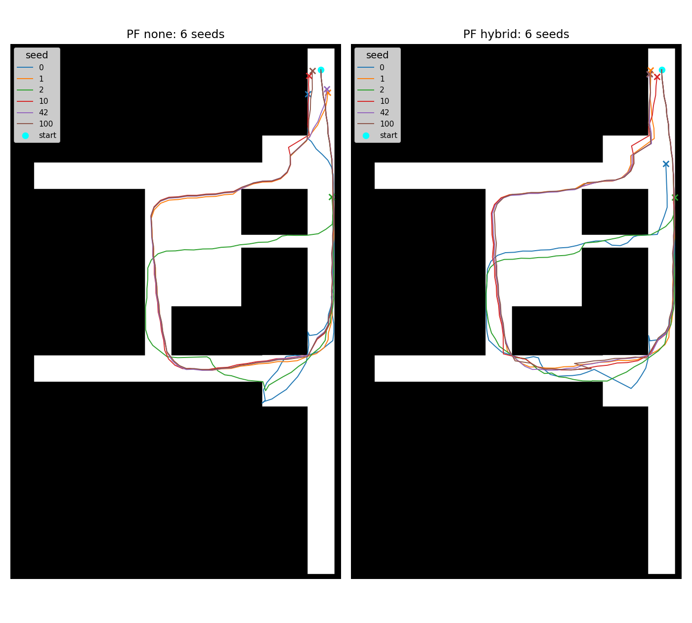

# パーティクルフィルタの現状整理（2026-10-21）

> 後続のユーザー指定で正しい地図は`Floormap_building14_5floor.png`と確認された。
> 本書はGroup18地図を使った過去条件の結果であり、正しい地図での現状判断には流用しない。
> 続きは[複数計測の原因調査](pf-investigation-20261021/README.md)を参照。

対象は `309-FixParticleFilter`、調査開始時HEADは `d9451f9`。製品コード・既定値は変更していません。

## 確認結果

直近Group18計測をBLEなし／hybrid各6 seedで実行しました。全12条件で出力座標は有限、壁交差0、復旧失敗0でした。一方、終点のseed間最大距離は12 m以上あり、通路枝選択は安定していません。正解軌跡がないため、終点誤差・RMSE・方式間の測位精度の優劣は判定できません。



線の色はseed、シアンの丸が開始、各色のXが終了です。途中経路にも枝の違いがあります。

## 処理の流れ

1. `prepare_pdr_steps()`が加速度・ジャイロから共通の歩列、方位、歩幅、運動状態の事後分布を生成します。通常PDRとPFでこの入力を共有します。
2. 各粒子は位置・方位ドリフト・方位補正・歩幅倍率・運動状態を保持します。開始位置は全粒子とも原点です。
3. 1歩ごとに状態と移動を提案し、線分が通る全画素の歩行可否を検査します。白側（グレースケール>128）が歩行可能です。
4. 地図制約、歩幅倍率の事前尤度、運動状態の予測尤度、任意のBLE尤度で重み付けします。
5. 粒子が不足した場合は局所回復→checkpoint再生→fallback→位置保持を試します。通常更新ではESSで再標本化します。
6. 到達可能クラスタによる時点別経路`current`と、単一祖先の経路`sequence`を比較し、ガード条件に従い代表軌跡を確定します。

入口は `src/rikka/particle/pipeline.py`、段階実行は `particle/lib/runner.py`、値の定義は `src/rikka/common/config/__init__.py` です。

## 現行パラメータ

### 粒子・方位・重み

| 設定 | 既定値 | 意味・実行時の注意 |
|---|---:|---|
| 粒子数 | 500 | CLI `--pf-particles` |
| seed | None | 通常実行は乱数固定なし。再現には`--pf-seed`が必要 |
| 初期方位sigma | 0.03 rad（1.72°） | 開始時の方位ドリフトのばらつき |
| 歩ごとの方位sigma | 0.01 rad（0.57°） | 実際は`max(設定値, 0.15 × 歩の方位標準偏差)` |
| 方位ドリフト保持率 | 0.85/歩 | 一時的なずれを減衰。回復の回避角も混入する |
| 再標本化後の方位sigma | 上限0.009 rad（0.52°） | 記録全体のmotion reliability中央値で0.004〜0.009 radに縮小 |
| ESS閾値 | 0.5N | 500粒子ではESS<250でsystematic resampling |
| 運動状態の予測尤度指数 | 0.1 | 尤度の過度な集中を緩和。CLIで変更可能 |
| 運動状態の滞在確率 | 0.82 | 前進・左右横歩き・旋回の遷移モデル |
| 推定／平滑化 | adaptive / causal | 上流の共通歩列の推定方式 |
| 代表経路設定 | sequence | 通常は根拠のない反転がcurrentより減る場合だけsequenceを採用。rangingには別の採用分岐あり |

今回のmotion reliability中央値は0.901160、再標本化後の実効方位sigmaは0.008710 rad（約0.499°）でした。全12条件とも実際の採用経路は`current`です。

### 歩幅

| 設定 | 既定値 |
|---|---:|
| 歩ごとの相対歩幅sigma | 0.01 |
| 歩幅倍率の事前平均 | 1.03 |
| 初期倍率sigma | 0.05 |
| 倍率偏差の保持率 | 0.995/歩 |
| 倍率の過程sigma | 0.002 |
| 再標本化後の倍率sigma | 0.003 |
| 倍率の上下限 | 0.90〜1.15 |

共通歩列の歩幅相対不確かさが0.18以上の歩が1つでもあると、実効上下限は0.60〜1.50、初期sigmaは最低0.12、再標本化sigmaは最低0.02になります。歩ごとの過程sigmaも`max(0.002, min(0.05, 0.12 × 相対不確かさ))`へ適応します。今回0.18以上の歩は0で、上下限拡張は発動していません。

上流の横歩き倍率は0.8、旋回倍率は0.3です。PF側で運動状態により歩幅を変更する処理は、校正信頼度と横歩きクラスタの条件付きです。歩幅事前平均1.03は既存の正解軌跡長に基づく値であり、別計測への一般化は別途評価が必要です。

### 回復・BLE

| 設定 | 既定値・条件 |
|---|---|
| 回復開始 | 正規化前の重み総和<=0、または正重みで壁を通らない粒子数が全粒子の5%未満 |
| 回復方位sigma | 0.08 rad（4.58°） |
| 回復最大試行設定 | 5。ただし局所候補生成の実装は最大2段 |
| 局所回復の角度候補 | 0、±5、±10、±20、±30、±45° |
| 旋回時の追加候補 | ±60、±90、±135、180° |
| 通常回復の歩幅候補 | 1.0、0.9、1.1倍。不確かさが高い場合は別候補 |
| 経路枝quota保護 | 既定無効 |
| BLE | 既定無効。使用時のPF既定方式はhybrid |
| BLE検出閾値／平滑化 | -70 dBm／5サンプル中央値 |
| BLE位置尤度sigma／下限 | 1.0 m／0.05 |
| hybridのreset条件 | 距離>2 m、かつ距離>粒子の位置RMS広がり×4 |
| 通常resetの上限／配置sigma | 5 m／1.0 m |
| reset時の方位sigma | 0.20 rad（11.46°） |
| 確定アンカー／経路retrofit | 既定アンカー空／retrofit無効 |

通常resetには5 m上限がありますが、位置sigmaを明示した確定アンカーには別処理があります。今回の3基は通常ランドマークです。

粒子数、seed、予測尤度指数、代表経路、BLE方式・retrofitはCLIから変更できます。方位ノイズ・歩幅状態・ESS・回復閾値は主に低水準APIの引数です。設定を変更する場合は、CLIの公開範囲と区別してください。

## Group18実行条件・結果

- センサー: `input/PDR Sensor Logger (Research) 2026-10-19 19-17-08`
- 地図: `input/Group18.png`、起点`(2972,245) px`、縮尺0.01 m/px、方位90°、身長1.68 m。
- BLE: 同ディレクトリの`BLE_sensor_overlap.csv`と`BLE_pos_Group18.csv`を使用。時刻移動は行っていません。
- 共通入力は89歩、BLE検出3件。seedは`0, 1, 2, 10, 42, 100`。
- 正解軌跡なし。終点は開始点を原点とするm座標です。

| 方式 | seed | 終点(x,y) m | 軌跡長m | 復旧・再生影響歩数 | checkpoint再生回数 |
|---|---:|---|---:|---:|---:|
| BLEなし | 0 | (-1.218, 2.339) | 70.628 | 18 | 0 |
| BLEなし | 1 | (0.668, 2.170) | 79.340 | 5 | 1 |
| BLEなし | 2 | (1.060, 12.150) | 75.591 | 13 | 1 |
| BLEなし | 10 | (-1.135, 0.546) | 80.786 | 3 | 0 |
| BLEなし | 42 | (0.577, 1.826) | 79.263 | 6 | 1 |
| BLEなし | 100 | (-0.818, 0.078) | 80.581 | 6 | 1 |
| hybrid | 0 | (0.401, 8.981) | 80.220 | 13 | 1 |
| hybrid | 1 | (-1.088, 0.066) | 81.353 | 2 | 0 |
| hybrid | 2 | (1.249, 12.228) | 73.190 | 15 | 2 |
| hybrid | 10 | (-0.439, 0.683) | 83.591 | 5 | 0 |
| hybrid | 42 | (-1.146, 0.420) | 80.637 | 3 | 0 |
| hybrid | 100 | (-1.138, 0.374) | 83.842 | 4 | 0 |

「復旧・再生影響歩数」は`recovery_mode`が`none`/`failed_hold`以外の診断行数で、BLE resetと過去歩の`checkpoint_replayed`も含みます。復旧イベントの発火回数とは異なります。checkpoint再生回数は`checkpoint_replay`行だけを数えています。

| 集計 | BLEなし | hybrid |
|---|---:|---:|
| 終点間の最大距離 | 12.217 m | 12.384 m |
| 軌跡長 中央値／最大 | 79.301 / 80.786 m | 80.995 / 83.842 m |
| 最大粒子位置広がり 中央値／最大 | 0.847 / 2.213 m | 0.981 / 1.246 m |
| 壁交差／復旧失敗 | 全seed 0 / 0 | 全seed 0 / 0 |

粒子群の内部の広がりが小さくても、別seedは違う枝へ収束できます。粒子の広がりを位置誤差と解釈できません。

### 歩別に確認できた点

- BLEなしseed 0は33歩で45°の局所回復、45歩で135°のturn-grid回復を記録しました。センサー由来の旋回と地図回復による旋回を区別して確認する必要があります。
- hybrid seed 0ではelpis_009を9歩目で観測し、elpis_010を40歩目で距離4.085 mからresetしました。elpis_011は59歩目で6.832 m離れており、5 m上限でresetをスキップしました。これらは診断CSVの1始まりの歩番号です。
- hybrid seed 0の78〜80歩は`checkpoint_replayed`、81歩は`checkpoint_replay`です。影響4歩を発火4回と数えないことが必要です。
- 壁回避角が方位ドリフトへ入り後続歩へ残る仕組みは現在もあります。過去のEXP-027と整合する実装ですが、今回のGroup18について同じ原因が誤差の主因だとは断定しません。

## 次に判断するための材料

優先するのは開始点・曲がり角の通過時刻・実際の通路枝の記録です。それを使って33〜45歩付近の方位と回復候補を確認し、方位・歩幅・回復・BLEのどこを変更すべきかを切り分けられます。粒子数やノイズを先に増やしても、地図上で合法な誤分岐を解消できる保証はありません。

既存EXP-056ではelpis_011の測距事前検査が不合格です。今回rangingは再実行しておらず、今回の調査だけで測距校正状態の改善は確認していません。

## 再現・検証

```sh
MPLBACKEND=Agg MPLCONFIGDIR=/private/tmp/rikka-pf-mpl \
  uv run python agent/agent_inspect_group18_pf.py \
  --output-dir /private/tmp/rikka-group18-pf-check
uv run pytest tests/test_pdr_regressions.py \
  -k 'particle or resampling or recovery or transition or reconstruct'
uv run ruff check
git diff --check
```

出力先は存在しない新規ディレクトリを指定します。キャッシュ権限エラー時だけ`UV_CACHE_DIR=.uv-cache`を追加してください。歩別CSV・軌跡CSV・比較PNGを確認後、自分が生成した一時ディレクトリだけ削除します。

固定seed関連25テスト成功、Ruff成功。12条件の軌跡比較図も目視確認しました。今回の検証出力は`/private/tmp`に作り、比較図と集計CSVを本書の成果物として複製後、一時ディレクトリを削除しました。既存`input/`・`output/`は変更していません。
